# 関西大学シラバス知識グラフ Database 比較実験報告書
## (Vector vs GraphDB / Hybrid GraphRAG Orthogonal Evaluation Report)

- **実施日**: 2026-11-10
- **実験種別**: チーム本実験（事前登録に基づく直交要因実験）
- **実験ブランチ**: `exp/graph-vector-eval`（コミット SHA: `5d6c8704381af72194e526726230a6d11a13357e`）
- **事前登録書 (SSOT)**: `backend/eval/prereg_kansai_eval.md`
- **ベンチマーク仕様**: `backend/eval/specs/kansai_query_specs.json`（全 24 問: 4 カテゴリ × 各 6 問）

---

### 冒頭の要約 (Executive Summary)

関西大学環境都市工学部（2026 年度開講シラバス 1,029 科目・卒業要件 136 件・科目群系統 DAG 22 エッジ）を対象に、完全に分離構築した実験用 PostgreSQL 18 (`cn-eval-pgvector` / `pgvector` HNSW) と Neo4j 5.26.27 (`cn-eval-neo4j`) の上で、5 手法（`C1: pg_pure_vector`, `C2: pg_vector_metadata`, `C3: neo4j_pure_graph`, `C4: neo4j_vector_only`, `C5: neo4j_hybrid_graphrag`）の直交比較を 24 問 × 5 回反復で実施した。

**結論**:
1. **明確なパレートトレードオフの実証**: 単一手法の全勝はなく、**RDB 属性制約 (`C2`) は単ホップ属性条件で最高適合・最低レイテンシ（NDCG@10 = `0.924`, CSR@10 = `0.950`, $L_{\text{med}} = 1.89\text{ ms}$）** を記録し、**Hybrid GraphRAG (`C5`) は多段前提順序探索（Cat 3）で `PVR@10 = 0.017`（違反ほぼゼロ）・`NDCG@10 = 0.793`**、代替探索（Cat 4）で最高網羅度（`Recall@10 = 0.889`）を達成した。
2. **設計上の新発見（Cat 1 における粗粒度グループ展開の逆効果）**: 非制約の抽象意味検索（Cat 1）では、`C1` / `C4`（Vector 単体）が `NDCG@10 = 0.552〜0.557`・`2.04 ms` で優勢であり、`C5` が同一 `CourseGroup` 展開まで RRF に混ぜると無関係科目混入と直積遅延（`64.96 ms`, `NDCG@10 = 0.429`）を招くことが判明した。実システムでは意図判定に基づく動的ルーティングが最適となる。

---

## 1. 目的と問い

本実験は、[vector-vs-graph-evaluation.md](vector-vs-graph-evaluation.md) および [ADR-0019](../adr/0019-adopt-neo4j-vector-index-and-isolate-pgvector-to-eval-branch.md) に基づき、以下の問いを定量的に解明することを目的として実施した：

1. 学生の曖昧な興味検索や履修順序・時間割制約を伴う推薦において、**単なるテキストベクトル検索（`pgvector`）のみで十分か**？
2. 履修系統図や要件枠を扱う上で、**GraphDB（Neo4j）および Hybrid GraphRAG を導入する技術的必然性** はどのタスク領域に現れるか？
3. RDB（`pgvector` + SQL `WHERE`）と GraphDB のそれぞれが得意・不得意とする境界（パレートフロンティア）はどこにあるか？

---

## 2. 仮説（事前登録）

事前登録書（`backend/eval/prereg_kansai_eval.md` §1.3）にて以下の 4 仮説を事前に凍結した：

- **H1（Pure Vector の限界）**: `C1` は抽象的意味検索（Cat 1）に強い一方、トポロジー制約を無視するため未修得前提科目の推薦による **PVR（前提条件違反率）** が高くなる。
- **H2（Vector + Metadata の実力と限界）**: `C2` は単ホップ属性制約（Cat 2）で高い適合度・低レイテンシを示すが、多段ホップ前提依存（Cat 3）は解決できない。
- **H3（Pure Graph の論理整合性と語彙限界）**: `C3` は前提順序の充足性（低 PVR）を保つが、非専門語彙クエリ（Cat 1）で適合度が低下する。
- **H4（Hybrid GraphRAG のパレート最適性）**: `C5` はベクトル類似度と 2 層カリキュラム DAG・類似エッジを統合し、意味適合度と論理整合性の双方で最良のパレートバランスを達成する。

---

## 3. 実行環境

| 項目 | 構成・実測値 |
| :--- | :--- |
| **実行日時 (JST)** | 2026-11-10 18:19:47 〜 18:19:53 (UTC 09:19:47 〜 09:19:53) |
| **ネットワーク隔離** | Docker 外部ネットワーク `gateway` 内部通信のみ使用（ホスト側ポート公開なし） |
| **実験 Postgres** | `cn-eval-pgvector`（`pgvector/pgvector:pg18`, 専用ボリューム `cn_eval_pgvector_data`） |
| **実験 Neo4j** | `cn-eval-neo4j`（`neo4j:5.26.27-community-trixie` + APOC, 専用ボリューム `cn_eval_neo4j_data`） |
| **コード Git SHA** | `5d6c8704381af72194e526726230a6d11a13357e`（`exp/graph-vector-eval`, clean tree 実行） |
| **Backend ソース指紋** | `sha256: 011ec963de0ca4c1a1d855876ee58ab2235a2f4d48d0e0e38b53a4e1aef669b4`（160 files） |
| **Embedding モデル** | `gemini-embedding-001`（768 次元, L2 正規化, 1,029 科目＋24 質問に完全同一ベクトルを投入） |
| **Embedding 整合性** | PG ⇔ Neo4j 間の 1,029 ベクトル SHA-256 不一致: **0 件**（`corpus_vectors_sha256: 186e6624...`） |
| **HNSW パラメータ** | `m=16, ef_construction=64, ef_search=40`（`vector_cosine_ops`） |

---

## 4. データと校正 (Corpus & Calibration)

### 4.1 コーパス母集団の厳密一致検証
本番稼働 Neo4j に混在していたシード 20 科目（`GMS-*`）を完全排除するため、実験専用 DB へ関西大学 2026 年度開講データのみをロードした。事前検証（`check-parity`）の実測値は次の通り：

- PostgreSQL (`courses`): **1,029 件**
- Neo4j (`:Course`): **1,029 件**（総ノード数 1,029、シード混入 **0 件**）
- 集合一致度 (**Jaccard 係数**): **1.000**（`pg_ids_sha256 == neo_ids_sha256: b2429101918bdc...`）
- グラフ構造実体: `CourseGroup` 18 件、`BELONGS_TO_GROUP` 65 本、`PREREQUISITE_FOR`（科目群間 DAG）22 本、`REQUIRES_PREREQUISITE`（直接前提）3 種、`CLASSIFIED_AS` 136 本、`SIMILAR_TO` 5,145 本（`gemini-embedding-001` 閾値 $\ge 0.70$, Top-5 で再構築）。

### 4.2 ベンチマーク 24 問と実 DB 事実に即した校正記録
`kansai_benchmark_dataset.md`（4 カテゴリ × 各 6 問 = 24 問）を実 DB へ解決する際、監査ログ（`ground_truth_resolution.json`）に記録した上で以下の校正を実施した：

1. **2026 年度未開講 3 科目の除外**: 履修系統図上は記載があるが `courses` 1,029 件に物理的に存在しない（`curriculum_group_graph.json` でも `syllabus_id: null` である）`グリーンケミストリー`・`エネルギー材料学`・`品質管理` を評価集合から除外し、Recall 分母の歪みを排除。
2. **表記揺れ正規化**: `物理化学Ⅰ` → `物理化学１`、`微分積分Ⅱ・演習Ⅱ` → `数学を学ぶ（微分積分２）` 等の全角数字・シラバス正式名への解決（残り 55 個の参照科目は 100% 実 `course_code` へ解決）。
3. **Cat 2（Q07, Q12）の開講学期ファクト校正**: 実 DB において `プロセス数理`・`熱・統計力学` が「2年次・秋」（原案は春扱い）、`物理化学２` が「2年次・春」、`プロセス最適化工学` が「3年次・春」（原案は秋扱い）、`シミュレーション演習` が「3年次・秋」であったため、SQL `WHERE` 評価の公平性を保つため実 DB の開講学期事実に合わせた。

---

## 5. 比較対象条件 (5 Approaches)

| 条件 ID | 手法名 | 実装メカニズム | 位置づけ |
| :--- | :--- | :--- | :--- |
| **C1** | `pg_pure_vector` | `eval_kansai_embeddings` に対する pgvector HNSW コサイン距離検索 | Vector 単体ベースライン |
| **C2** | `pg_vector_metadata` | `C1` + `courses` テーブルの `year_range` / `semester` SQL `WHERE` 絞り込み | RDB 属性フィルタ対照群 |
| **C3** | `neo4j_pure_graph` | CJK 全文検索 (`eval_kansai_fulltext`) ＋ 2 層前提 DAG（`REQUIRES_PREREQUISITE` & `CourseGroup.PREREQUISITE_FOR`） | Pure Graph ベースライン |
| **C4** | `neo4j_vector_only` | `db.index.vector.queryNodes('course_embedding_index')` 単体実行 | **校正対照群 (Sanity Check)** |
| **C5** | `neo4j_hybrid_graphrag` | Vector Index ＋ 2 層前提 DAG / `BELONGS_TO_GROUP` / `SIMILAR_TO` / 属性フィルタのタスク適応 Cypher 統合 | 提案 Hybrid GraphRAG |

*全条件共通ルール*: 同一 `course_code`（複数クラス）は最高スコア代表 1 件に集約し、起点科目指定時（Cat 3, Cat 4）は起点自身を除外して上位 $K \in \{5, 10\}$ を評価した。

---

## 6. 手順と事前信頼性チェック

1. **HNSW 近似誤差検証 (`check-hnsw`)**:
   24 問すべてで pgvector HNSW（`ef_search=40`）と厳密全件走査（`SET enable_indexscan = off`）の上位 10 件を比較した結果、**平均 Recall@10 一致率 = 99.58%**（合格基準 $\ge 98.0\%$ をクリア）。`EXPLAIN` にて `Index Scan using idx_eval_kansai_embeddings_hnsw` の使用を確認済み（`hnsw_validation.json`）。
2. **本計測 (`retrieve`)**:
   各（条件, 質問）ペアでコールドスタート除外のウォームアップ 1 回後、5 回反復実行し、全 120 組× 5 回すべてで順位の完全決定論的一貫性を確認した。

---

## 7. 評価指標の定義

事前登録書 §5 に定義された 6 指標を使用：
- **Recall@K**, **NDCG@K**（$\text{rel} \in \{0, 1, 2\}$）
- **PVR@K**（前提条件違反率：推薦上位 $K$ 件のうち、既修得 $S_{\text{taken}}$ で満たせない 1 ホップ前提科目または直接前提を持つ科目の割合）
- **PPC@K**（前提パス網羅度：目標科目の必須前提パスのうち上位 $K$ 件に含まれた割合、Cat 3 対象）
- **CSR@K**（制約適合率：指定の配当年次・開講学期制約を満たす科目の割合、Cat 2 対象）
- **Forbidden@10**（出してはいけない禁止科目の混入累計件数）、**$L_{\text{med}}$**（レイテンシ中央値 ms）、**$N_{\text{query}}$**（物理 DB クエリ数）

---

## 8. 実験結果

### 8.1 カテゴリ別・手法別 定量評価

#### Cat 1: 意味・抽象テーマ探索（Q01〜Q06）
| 条件 | Recall@5 | NDCG@5 | Recall@10 | NDCG@10 | PVR@10 | Forbidden@10 | $L_{\text{med}}$ (ms) | $N_{\text{query}}$ |
| :--- | :---: | :---: | :---: | :---: | :---: | :---: | :---: | :---: |
| `C1_pg_pure_vector` | **0.556** | 0.505 | **0.667** | 0.552 | 0.750 | 0 | 2.04 | 1.0 |
| `C2_pg_vector_metadata` | **0.556** | 0.505 | **0.667** | 0.552 | 0.750 | 0 | **1.99** | 1.0 |
| `C3_neo4j_pure_graph` | 0.444 | 0.402 | 0.500 | 0.429 | **0.433** | 0 | 3.93 | 1.0 |
| `C4_neo4j_vector_only` | **0.556** | **0.510** | **0.667** | **0.557** | 0.750 | 0 | 6.37 | 1.0 |
| `C5_neo4j_hybrid_graphrag` | 0.278 | 0.279 | 0.611 | 0.429 | 0.767 | 0 | 64.96 | 1.0 |

#### Cat 2: 属性制約付き探索（Q07〜Q12）
| 条件 | Recall@5 | NDCG@5 | Recall@10 | NDCG@10 | PVR@10 | CSR@10 | Forbidden@10 | $L_{\text{med}}$ (ms) | $N_{\text{query}}$ |
| :--- | :---: | :---: | :---: | :---: | :---: | :---: | :---: | :---: | :---: |
| `C1_pg_pure_vector` | 0.611 | 0.534 | 0.708 | 0.585 | 0.150 | 0.250 | 12 | 1.91 | 1.0 |
| `C2_pg_vector_metadata` | 0.875 | 0.868 | **1.000** | **0.924** | 0.067 | **0.950** | **0** | **1.89** | 1.0 |
| `C3_neo4j_pure_graph` | **0.944** | **0.896** | **1.000** | 0.922 | **0.033** | 0.600 | **0** | 2.81 | 1.0 |
| `C4_neo4j_vector_only` | 0.611 | 0.534 | 0.708 | 0.583 | 0.150 | 0.250 | 12 | 6.81 | 1.0 |
| `C5_neo4j_hybrid_graphrag` | 0.875 | 0.868 | **1.000** | **0.924** | 0.067 | **0.950** | **0** | 3.95 | 1.0 |

#### Cat 3: 前提条件・履修シーケンス探索（Q13〜Q18）
| 条件 | Recall@5 | NDCG@5 | Recall@10 | NDCG@10 | PVR@10 | PPC@10 | Forbidden@10 | $L_{\text{med}}$ (ms) | $N_{\text{query}}$ |
| :--- | :---: | :---: | :---: | :---: | :---: | :---: | :---: | :---: | :---: |
| `C1_pg_pure_vector` | 0.542 | 0.546 | 0.583 | 0.565 | 0.367 | 0.583 | 2 | **1.89** | 1.0 |
| `C2_pg_vector_metadata` | 0.542 | 0.546 | 0.583 | 0.565 | 0.367 | 0.583 | 2 | 2.01 | 1.0 |
| `C3_neo4j_pure_graph` | 0.264 | 0.233 | 0.597 | 0.382 | **0.017** | 0.597 | **0** | 3.40 | 1.0 |
| `C4_neo4j_vector_only` | 0.542 | 0.556 | 0.583 | 0.576 | 0.350 | 0.583 | 2 | 6.86 | 1.0 |
| `C5_neo4j_hybrid_graphrag` | **0.694** | **0.704** | **0.861** | **0.793** | **0.017** | **0.861** | **0** | 4.19 | 1.0 |

#### Cat 4: カリキュラム補完・代替探索（Q19〜Q24）
| 条件 | Recall@5 | NDCG@5 | Recall@10 | NDCG@10 | PVR@10 | Forbidden@10 | $L_{\text{med}}$ (ms) | $N_{\text{query}}$ |
| :--- | :---: | :---: | :---: | :---: | :---: | :---: | :---: | :---: |
| `C1_pg_pure_vector` | 0.556 | 0.413 | 0.722 | 0.490 | 0.167 | 0 | **1.82** | 1.0 |
| `C2_pg_vector_metadata` | 0.556 | 0.413 | 0.722 | 0.490 | 0.167 | 0 | 1.86 | 1.0 |
| `C3_neo4j_pure_graph` | **0.639** | **0.555** | 0.833 | **0.643** | **0.000** | 0 | 5.81 | 1.0 |
| `C4_neo4j_vector_only` | 0.556 | 0.421 | 0.722 | 0.498 | 0.167 | 0 | 6.38 | 1.0 |
| `C5_neo4j_hybrid_graphrag` | 0.528 | 0.460 | **0.889** | 0.609 | 0.067 | 0 | 6.83 | 1.0 |

---

### 8.2 カテゴリ別プロファイル可視化 & 多軸パレートフロンティア

> 事前登録規約 §7 に従い、単一合算スコアではなくカテゴリ別の適合度比較および「前提充足度 ($1 - \text{PVR@10}$) vs 意味適合度 ($\text{NDCG@10}$)」のパレート分析を提示する。

```mermaid
xychart-beta
    title "Category-wise NDCG@10 across C1 / C2 / C3 / C5 (Higher is Better)"
    x-axis ["Cat1: Semantic", "Cat2: Metadata", "Cat3: Prereq DAG", "Cat4: Substitution"]
    y-axis "Mean NDCG@10" 0.0 --> 1.0
    bar "C1 Pure Vector" [0.552, 0.585, 0.565, 0.490]
    bar "C2 Vector+Meta" [0.552, 0.924, 0.565, 0.490]
    bar "C3 Pure Graph" [0.429, 0.922, 0.382, 0.643]
    bar "C5 Hybrid GraphRAG" [0.429, 0.924, 0.793, 0.609]
```



#### 多軸パレートフロンティア集計（全 24 問におけるトレードオフ位置）

| 条件 | 前提充足度 ($1 - \text{PVR@10}$) | 意味適合度 ($\text{NDCG@10}$) | レイテンシ中央値 (ms) | パレート位置づけ |
| :--- | :---: | :---: | :---: | :--- |
| `C1_pg_pure_vector` | 0.642 | 0.548 | **1.89** | 超低遅延だがトポロジー違反最多 |
| `C2_pg_vector_metadata` | 0.663 | 0.633 | 1.97 | Cat 2 特化・低遅延領域のフロンティア |
| `C3_neo4j_pure_graph` | **0.879** | 0.594 | 3.92 | **論理整合性上限（意味検索では劣後）** |
| `C4_neo4j_vector_only` | 0.646 | 0.554 | 6.49 | 校正対照群（`C1` と精度ほぼ同一、DB 差 ≈ 4.6 ms） |
| `C5_neo4j_hybrid_graphrag` | 0.771 | **0.689** | 6.54 | **意味適合度上限・高整合のパレートフロンティア** |

```text
  NDCG@10 (意味適合度)
   0.75 |
   0.70 |                                       ★ C5 (Hybrid GraphRAG: 0.771, 0.689)
   0.65 |          ● C2 (0.663, 0.633)
   0.60 |                                                            ◆ C3 (Pure Graph: 0.879, 0.594)
   0.55 |  ▲ C1 (0.642, 0.548) / ○ C4 (0.646, 0.554)
   0.50 +-------------------------------------------------------------------------------->
       0.60       0.65       0.70       0.75       0.80       0.85       0.90  (1 - PVR@10: 前提充足度)
```

---

## 9. 事前登録との照合

| 仮説 | 事前登録予測 | 実測判定 | 根拠となる実測データ |
| :--- | :--- | :---: | :--- |
| **H1 (Pure Vector)** | 抽象探索に強いが前提違反が高い | **支持** | Cat 1 で `NDCG@10 = 0.552` と優勢一方、Cat 3 で `PVR@10 = 0.367`（Q13 では 0.50: `プロセス最適化工学` など 3 年次科目を無批判に推薦）。 |
| **H2 (Vector+Meta)** | 単ホップ制約で最高適合・低遅延、多段前提に無力 | **支持** | Cat 2 で `NDCG@10 = 0.924`・`CSR@10 = 0.950`・`1.89 ms`（`C5` の `3.95 ms` より約 2.1 倍高速）。一方 Cat 3 では `C1` と同値（`PVR@10 = 0.367`）。 |
| **H3 (Pure Graph)** | 低 PVR だが非専門語彙で適合度低下 | **支持** | 全体の前提充足度 `0.879` で最高・Forbidden `0` だが、Cat 1 で `NDCG@10 = 0.429`（語彙不一致）および Cat 3 で関連順位付け不足（`NDCG@10 = 0.382`）。 |
| **H4 (Hybrid GraphRAG)** | 適合度と整合性のパレート最適解 | **部分支持（重要知見あり）** | Cat 3 (`NDCG@10 = 0.793, PVR@10 = 0.017, PPC@10 = 0.861`)・Cat 4 (`Recall@10 = 0.889`) で圧倒的優位。ただし Cat 1 では粗粒度 `CourseGroup` の無条件 RRF 展開がノイズとなり Vector 単体に劣後（§10 参照）。 |
| **Sanity Check (C1 vs C4)** | ベクトル単体の DB エンジン差のみ分離 | **達成** | `C1` (`NDCG@10 = 0.548`, `1 - PVR = 0.642`) と `C4` (`0.554`, `0.646`) は精度がほぼ完全一致し、純粋なエンジン走査差（pgvector `1.89 ms` vs Neo4j `6.49 ms`）のみが抽出された。 |

---

## 10. 考察（システム設計への示唆）

1. **なぜ GraphDB が履修支援において技術的必然性を持つか（Cat 3・Cat 4）**:
   実例（Q13 `化学プラント設計` の前提探索）において、`C1/C2`（Vector）はシラバス文脈が似た同学年・後続の発展科目（`プロセス最適化工学`, `応用反応工学`）を上位に並べてしまい、1 年次修了学生にとって履修不可能な科目ばかりを提示した（`PVR = 0.50`）。また Cat 4（Q19）では Vector 単体が卒研科目（`特別研究１・２`）を代替候補に混ぜた。これに対し、`C5` は `CourseGroup` と `REQUIRES_PREREQUISITE` の 2 層 DAG を辿ることで **`PVR = 0.00` を保証しつつ、目的科目に関連する前提科目（`反応工学`, `ユニットオペレーション１`）をベクトル類似度で最上位へ再ランキング（`NDCG@10 = 0.725`）** することに成功した。
2. **PostgreSQL + pgvector が優位に立つ明確な領域（Cat 1・Cat 2）**:
   1,000 件規模の単ホップ属性フィルタ（Cat 2）では、`pgvector` + SQL `WHERE`（`1.89 ms`）が Neo4j Vector + Cypher（`3.95 ms`）の約半分以下のレイテンシで完全同一の最高精度（`NDCG@10 = 0.924`）を達成した。
3. **Cat 1 で判明した「粗粒度グループ展開」の罠と本番実装への提言**:
   Cat 1 において `C5` は 2 つの `OPTIONAL MATCH`（`SIMILAR_TO` × `BELONGS_TO_GROUP`）を同一句で直積展開したため、シードが所属する 1 年次まとめグループ（`G_1Y_ChemEng`）内の無関係科目（例: Q01 で `プロセス量論及び演習` や `フレッシュマンゼミナール`）が RRF で上位に割り込み、`NDCG@5` が `0.505 → 0.279` へ低下しクエリ時間も `64.96 ms` に増加した。
   → **結論として、全クエリを一律に RRF 展開するのではなく、「抽象トピック検索（Cat 1）＝ Vector 単体（または `SIMILAR_TO` のみ）」「制約絞り込み（Cat 2）＝ メタデータフィルタ」「前提・代替探索（Cat 3/4）＝ Graph + Vector ハイブリッド」という意図判定ベース（Intent Routing）のハイブリッド設計が最も合理的である。**

---

## 11. 限界

1. **データ規模**: 1 学部 1,029 科目規模の検証であり、全学数万科目規模では HNSW（pgvector）と Lucene HNSW（Neo4j）のメモリ効率・スループット特性がさらに大きく開く可能性がある。
2. **質問セット数**: 4 カテゴリ × 各 6 問（計 24 問）の課題駆動ベンチマークであり、p 値による統計的検定ではなく記述統計および直交対照によるメカニズム検証である。
3. **前提関係モデルの粒度**: 今回の `Prereq(c)` は公式履修系統図（`CourseGroup` 間 `PREREQUISITE_FOR`）と直接 `REQUIRES_PREREQUISITE` から構築しており、個別のシラバス自由記述内にのみ記載された暗黙前提までは含まれていない。

---

## 12. 生データとコードの場所

実験コード・インフラ定義・生データ一式は **`exp/graph-vector-eval`** ブランチに分離格納されている：

- 実験用分離インフラ定義: `db/compose.eval.yaml` (`exp/graph-vector-eval`)
- 事前登録書: `backend/eval/prereg_kansai_eval.md` (`exp/graph-vector-eval`)
- コーパス・同期ローダー: `backend/eval/kansai_corpus.py`, `backend/eval/load_kansai_eval_db.py` (`exp/graph-vector-eval`)
- 5 手法 Retriever & メトリクス: `backend/eval/kansai_retrievers.py`, `backend/eval/kansai_metrics.py`, `backend/eval/kansai_compare.py` (`exp/graph-vector-eval`)
- 確定 24 問ベンチマーク & 校正ログ: `backend/eval/specs/kansai_query_specs.json`, `backend/eval/results/ground_truth_resolution.json` (`exp/graph-vector-eval`)
- 母集団・HNSW 検証結果: `backend/eval/results/corpus_id_parity.json`, `backend/eval/results/hnsw_validation.json` (`exp/graph-vector-eval`)
- 120 試行生データ・Manifest・集計表: `backend/eval/results/kansai_eval_runs.jsonl`, `backend/eval/results/kansai_eval_manifest.json`, `backend/eval/results/kansai_eval_summary.md` (`exp/graph-vector-eval`)
