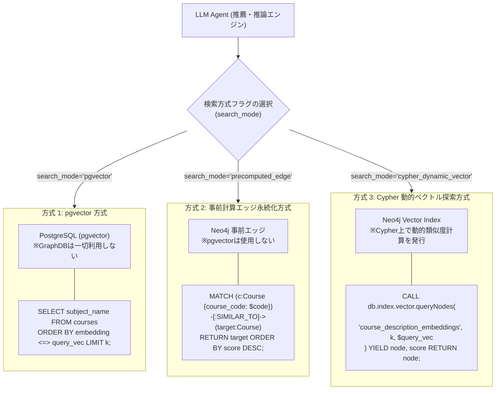
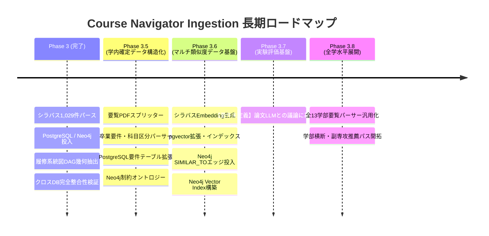

# 高度な学内データ活用に向けた長期的 Ingestion 実装計画書 (改訂版)

本ドキュメントは、大学シラバスおよび履修系統図の初期パイプライン（Phase 3）の完了を受け、**学内に存在する公式データ（大学要覧・履修規程）の徹底的な有効活用**と、**研究開発段階における3つの類似度検索アプローチ（pgvector / 事前計算エッジ / Cypher動的探索）のマルチ基盤整備**を段階的に推進するための長期実装計画書です。

---

## 1. エグゼクティブサマリーと設計方針

### 1.1 背景とスコープの明確化
`docs/architecture.md` では将来的な多層知識構造（第1層: CS2023 基準オントロジー、第4層: 外部Web学習教材）が定義されていますが、**本計画ではあえて外部オントロジーへのマッピングには進まず、学内データの徹底的な有効活用にフォーカス**します。
大学内にはシラバス以外にも「大学要覧」「履修規程」「卒業要件表」など極めて重要な公式文書が存在していますが、これらはこれまで未構造化な PDF のまま放置され、システムに組み込まれていませんでした。

### 1.2 コアな目的
1. **確定的な学内公式データの網羅**: 大学要覧（`all_page.pdf`）から、これまでシラバス単体では取得できなかった「必修/選択必修/選択区分」「卒業所要単位」「卒業研究着手要件」を決定論的に抽出・DB化する。
2. **3つの類似度探索方式のマルチ基盤整備**: 本システムが研究開発段階にあることから、Agent がフラグにより① `pgvector` 方式、② 事前計算エッジ永続化方式、③ Cypher 動的ベクトル探索方式の3系統を選択できるようにし、後に評価測定を行えるデータ基盤を構築する。
3. **実験評価基盤の扱い（未定義）**: LLM 回答への影響を検証する実験基盤については、「論文LLM」との議論により詳細が決定されるため、本システム実装の要件としては現時点で「未定義（Pending）」と位置づける。

---

## 2. 現状調査結果：存在しないが必要なデータ資産 (Gap Analysis)

リポジトリ内のコード、ドキュメント（`architecture.md`、ADR-0001〜0016）、およびデータファイルを横断調査した結果、以下のギャップが特定されました。

| 分類 | データ項目 / エンティティ | 参照元ドキュメント | 現状の実装ステータス | 本計画での対応 |
| :--- | :--- | :--- | :--- | :--- |
| **学内規程データ** | **科目区分 (`requirement_type`)**<br>（必修・選択必修・選択） | 大学要覧 (Pages 332-333) | ❌ **未保持**<br>(シラバスには記載なし) | 要覧 PDF 解析により全科目に確定フラグを付与（Phase 3.5） |
| **学内規程データ** | **卒業所要単位内訳 (`GraduationRequirement`)** | 大学要覧 (Page 328) | ❌ **未保持** | 共通教養20・外語12・専門96（必修53/選必30以上）を構造化（Phase 3.5） |
| **学内規程データ** | **特別研究（卒研）着手要件** | 大学要覧 (Pages 330-331) | ❌ **未保持** | 未修得上限・実験修得必須・特別研究Ⅰ前提ルールをDB化（Phase 3.5） |
| **学内規程データ** | **個別科目間の前提エッジ (`[:REQUIRES_PREREQUISITE]`)** | シラバス本文、ADR-0005 | ⚠️ **部分保持**<br>(CourseGroup間のみ) | 科目グループDAGを基盤としつつ、個別前提エッジを多重化（Phase 3.5） |
| **データサイエンス** | **3系統の類似度検索データ**<br>(pgvector / 事前エッジ / Vector Index) | architecture.md §1.3, ADR-0016 | ❌ **未保持** | Ingestion 層で3方式すべてのデータ投入を完備（Phase 3.6） |
| **実験・評価基盤** | **評価実験設計・メトリクス** | ADR-0006 | ⚠️ **要件未定義** | 論文LLMとの議論により後日決定（本実装要件外） |

---

## 3. 大学要覧 PDF（`all_page.pdf`）の構造解析結果

`ingestion/data/raw/university/kansai/2026/bulletin/all_page.pdf`（全371ページ）のテキスト抽出・構造分析を行いました。

### 3.1 学部別ページ配分
全13学部の要覧・規程が1冊にまとまっています：
- 法学部: Pages 1 - 57
- 経済学部: Pages 58 - 76
- 商学部: Pages 77 - 105
- 社会学部: Pages 106 - 138
- 政策創造学部: Pages 140 - 158
- 外国語学部: Pages 160 - 184
- 人間健康学部: Pages 186 - 210
- 総合情報学部: Pages 212 - 234
- 社会安全学部: Pages 235 - 254
- ビジネスデータサイエンス学部: Pages 256 - 268
- システム理工学部: Pages 269 - 308
- **環境都市工学部**: **Pages 310 - 336** (プロトタイプ対象)
- 化学生命工学部: Pages 338 - 360

### 3.2 エネルギー環境・化学工学科（Pages 328 - 333）の確定データ
1. **卒業所要単位内訳 (Page 328)**:
   - 共通教養科目: 20単位（指定科目12単位以上、自己形成2領域以上各2単位）
   - 外国語科目: 12単位（第1外国語8単位、第2外国語4単位）
   - 専門教育科目: 96単位（**必修53単位**、**選択必修30単位以上**、選択任意）
   - 合計卒業所要単位: **128単位**
2. **卒業研究（特別研究Ⅰ・Ⅱ）の着手要件 (Pages 330 - 331)**:
   - 専門教育科目の必修未修得が4科目8単位以内
   - 選択必修科目を24単位以上修得済み
   - 「化学工学実験」「有機化学実験」を修得済み
   - 「特別研究Ⅰ」修得が「特別研究Ⅱ」の前提
3. **科目一覧表と区分 (Pages 332 - 333)**:
   - 必修科目（53単位分）: `線形代数Ⅰ/Ⅱ`, `化学実験`, `物理化学Ⅰ〜Ⅲ`, `化学工学実験`, `特別研究Ⅰ/Ⅱ` など全25科目
   - 選択必修科目（30単位以上）: `基礎分析化学`, `物理化学演習`, `粉体工学`, `プロセス制御工学` など全18科目
   - 選択科目: `情報処理演習`, `熱・統計力学`, `シミュレーション演習` など全22科目

---

## 4. 類似度検索アーキテクチャ設計（3つの探索方式のフラグ切り替え）

本システムでは、**研究開発段階における比較検証を可能にするため、Agent がフラグにより以下の3つの検索方式を選択できる設計を採用**します。Ingestion パイプラインは、これら 3 方式のすべてを成立させるデータ基盤を網羅的に構築・投入します。



### 3つの検索方式の比較と位置づけ

| 検索方式 | 利用データストア | 動作メカニズム | Ingestion 側の整備責務 |
| :--- | :--- | :--- | :--- |
| **① `pgvector` 方式** | **PostgreSQL のみ**<br>(GraphDB は一切使用しない) | `courses` テーブルに `vector` 型カラムを追加し、PostgreSQL ネイティブのコサイン距離インデックス（HNSW）で類似検索。 | `courses` テーブルに `embedding` 列および pgvector インデックスを追加し、全科目のベクトルを格納。 |
| **② 事前計算エッジ永続化方式** | **Neo4j のみ**<br>(pgvector は使用しない) | Ingestion 時にあらかじめ類似度閾値（例: $\ge 0.75$）以上のペアを計算し、`(:Course)-[:SIMILAR_TO {score}]->(:Course)` として静的エッジを永続化。Cypher のポインタ探索のみで完結。 | 全ペア類似度マトリクスをバッチ計算し、Neo4j に `[:SIMILAR_TO]` エッジを一括バッチロード。 |
| **③ Cypher 動的ベクトル探索方式** | **Neo4j のみ** | Neo4j 内部に Vector Index を構築し、Cypher クエリ内で `CALL db.index.vector.queryNodes(...)` を発行して動的に類似ノードを探索・多段グラフと結合。 | Neo4j ノードの属性に `embedding` リストプロパティを保持させ、Neo4j Vector Index を宣言・構築。 |

---

## 5. 長期フェーズ構成 (Phase Breakdown)



### Phase 3.5: 大学要覧データの完全構造化と制約オントロジーの構築
- **目的**: 学内確定ルール（必修・選必区分、卒業要件、着手要件）の完全構造化。
- **タスク**:
  1. `bulletin_splitter.py`: 全371ページの `all_page.pdf` を学部別に自動分割。
  2. `bulletin_parser.py`: 環境都市工学部エネルギー環境・化学工学科の表組みから、科目ごとの `requirement_type`（必修/選必/選）および卒業要件・着手要件を抽出。
  3. PostgreSQL テーブル拡張:
     - `graduation_requirements`: 学科ごとの卒業所要単位内訳マスター。
     - `course_requirement_types`: 科目ごとの学科別必修区分マスター。
  4. Neo4j オントロジー拡張:
     - `(:GraduationRequirement)` ノードの作成。
     - `(:Course)-[:CLASSIFIED_AS {type, department}]->(:RequirementType)`。

### Phase 3.6: 3つの類似度探索方式を支えるマルチデータ基盤の構築
- **目的**: Agent が 3 方式（pgvector / 事前計算エッジ / Cypher動的探索）を選択できるデータ基盤の整備。
- **タスク**:
  1. `similarity_builder.py`:
     - シラバスの講義概要（`description`）、到達目標（`objectives`）、15回計画（`schedule_sessions`）からベクトル埋め込み（Embedding）を生成。
  2. **方式① pgvector**:
     - PostgreSQL に `pgvector` 拡張を導入し、`courses` テーブルに `embedding` 列および HNSW インデックスを追加・格納。
  3. **方式② 事前計算エッジ永続化**:
     - 閾値以上のペアについて、Neo4j に `(:Course)-[:SIMILAR_TO {score, model}]->(:Course)` エッジを一括バッチロード。
  4. **方式③ Cypher 動的ベクトル探索**:
     - Neo4j の `Course` ノードに `embedding` 配列プロパティを保持し、Neo4j Vector Index を構築。

### Phase 3.7: 実験評価基盤（要件未定義）
- **位置づけ**:
  - 実験基盤の詳細仕様（ゴールデン質問セット、評価メトリクス、測定手法等）については、「論文LLM」が存在するため、そちらとの議論により決定されます。
  - したがって、**本システム実装の要件としては現時点で「未定義（Pending / External Decision）」**として扱います。

### Phase 3.8: 全学（全13学部）への水平展開
- 全学部の要覧 PDF 解析エンジンの汎用化。
- 文理融合、他学部履修（配当外科目）、副専攻カリキュラム推薦のグラフ接続。

---

## 6. 実装ファイル構成

```text
ingestion/
├── src/
│   ├── transformers/
│   │   └── kansai/
│   │       ├── bulletin_splitter.py          # [Phase 3.5] 要覧スプリッター
│   │       ├── bulletin_parser.py            # [Phase 3.5] 卒業要件・必修区分パーサー
│   │       └── similarity_builder.py         # [Phase 3.6] Embedding & 類似度計算
│   └── loaders/
│       ├── postgres/
│       │   ├── schema_requirements.py        # [Phase 3.5] 要件テーブル DDL
│       │   ├── loader_requirements.py        # [Phase 3.5] 要件 PostgreSQL ロード
│       │   └── loader_pgvector.py            # [Phase 3.6] 方式①: pgvector ロード
│       └── graph/
│           ├── requirements_loader.py        # [Phase 3.5] 要件 Neo4j ロード
│           ├── similarity_edge_loader.py     # [Phase 3.6] 方式②: [:SIMILAR_TO] エッジ一括ロード
│           └── similarity_vector_index.py    # [Phase 3.6] 方式③: Neo4j Vector Index 構築
└── tests/
    ├── test_bulletin_parser.py               # [Phase 3.5] 要覧パーサー単体テスト
    ├── test_similarity_builder.py            # [Phase 3.6] 類似度計算単体テスト
    └── test_pgvector_loader.py               # [Phase 3.6] pgvector ロード単体テスト
```

---

## 7. 検証および評価手順

```bash
# 1. 要覧の分割と抽出 (Phase 3.5)
docker compose --profile tools run --rm ingestion uv run python -m src.transformers.kansai.bulletin_splitter
docker compose --profile tools run --rm ingestion uv run python -m src.transformers.kansai.bulletin_parser --faculty env --dept cee

# 2. PostgreSQL & Neo4j への要件データ投入と突合検証 (Phase 3.5)
docker compose --profile tools run --rm ingestion uv run python -m src.loaders.postgres.loader_requirements
docker compose --profile tools run --rm ingestion uv run python -m src.loaders.graph.requirements_loader

# 3. 類似度 Embedding の生成 (Phase 3.6)
docker compose --profile tools run --rm ingestion uv run python -m src.transformers.kansai.similarity_builder

# 4. 方式① pgvector への投入
docker compose --profile tools run --rm ingestion uv run python -m src.loaders.postgres.loader_pgvector

# 5. 方式② Neo4j 事前計算エッジのロード
docker compose --profile tools run --rm ingestion uv run python -m src.loaders.graph.similarity_edge_loader --threshold 0.75

# 6. 方式③ Neo4j Vector Index の構築
docker compose --profile tools run --rm ingestion uv run python -m src.loaders.graph.similarity_vector_index
```
