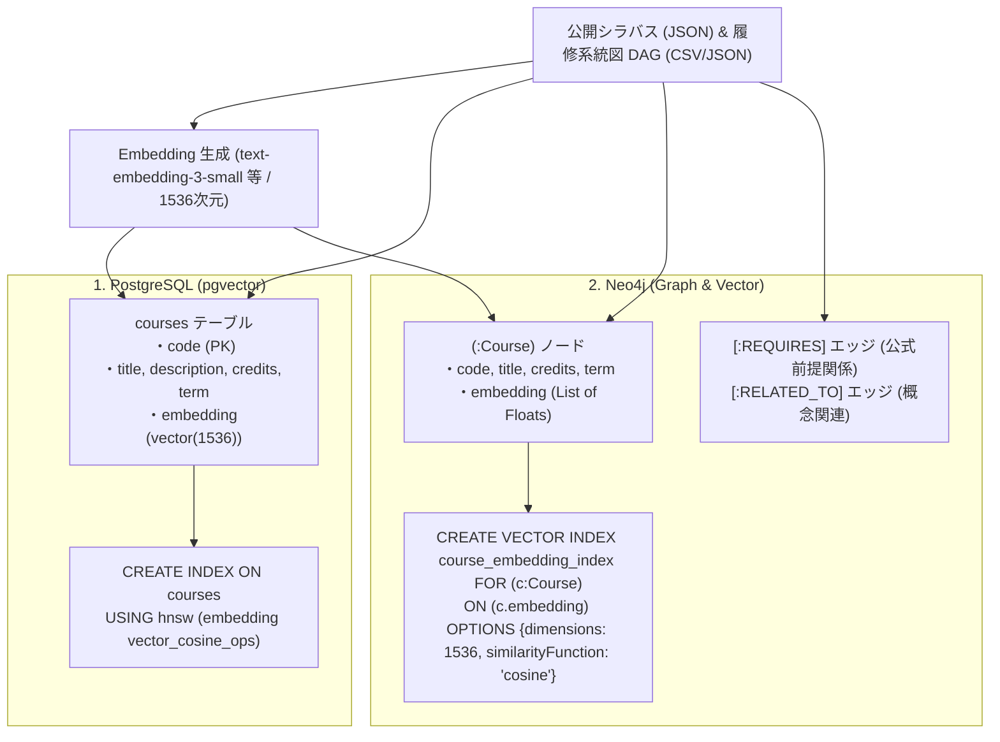
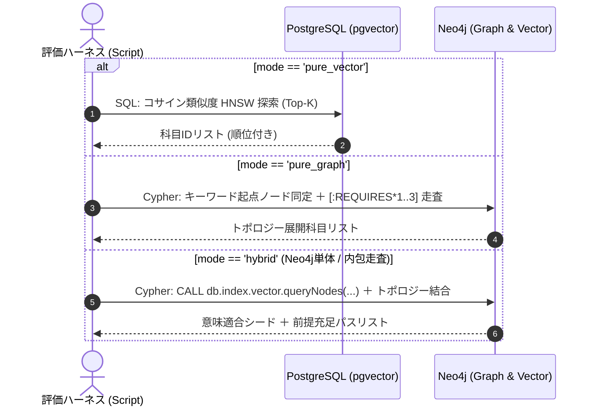
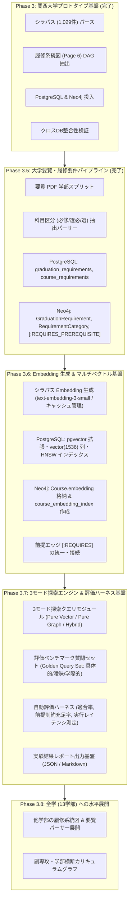

# 高度な学内データ活用および3つの探索実験基盤に向けた長期 Ingestion 実装計画書 (改訂版)

本ドキュメントは、大学シラバスおよび履修系統図の初期パイプライン（Phase 3）ならびに大学要覧パイプライン（Phase 3.5）の完了を受け、**論文精査LLMから提示・合意された「3つの実験方式（Pure Vector / Pure Graph / Hybrid）のためのシステム・データ基盤実装設計」** を取り込み、長期実装計画（Phase 3.6 および Phase 3.7）を具体化・改訂したものです。

---

## 1. エグゼクティブサマリーと設計方針

### 1.1 背景とスコープの明確化
`docs/architecture.md` では将来的な多層知識構造（第1層: CS2023 基準オントロジー、第4層: 外部Web学習教材）が定義されていますが、**本計画ではあえて外部オントロジーへのマッピングには進まず、学内データの徹底的な有効活用にフォーカス**します。
学内の公式データ（シラバス、履修系統図、大学要覧・履修規程）を高精度に構造化し、学内の閉じたデータ空間で最も信頼性の高い履修支援・検索基盤を実現すること、および**3つの探索モードの比較実験基盤を確立すること**に集中します。

> [!IMPORTANT]
> **本番アプリケーションにおける pgvector 非採用と実験専用ブランチ分離の方針**:
> 本アプリケーション（メインブランチ）においては、**PostgreSQL (pgvector) は採用せず、Neo4j（Graph + Vector Index）を中核データストアとして採用**します。
> pgvector による Pure Vector 探索方式は、論文・実験比較の検証専用であるため、メインブランチの標準データ投入パイプラインからは除外し、**後日ブランチを変更して（実験用ブランチにて）実験・検証を行います**。
> したがって、メインブランチにおけるデータパイプラインは、**Neo4j への Embedding 生成・投入、Vector Index 構築、およびセマンティック類似度エッジ（`[:SIMILAR_TO]`）の永続化** を中心に構築します。

### 1.2 コアな目的と達成状況
1. **確定的な学内公式データの網羅 (Phase 3.5 完了)**: 大学要覧（`all_page.pdf`）から、「必修/選択必修/選択区分」「卒業所要単位」「卒業研究着手要件」を決定論的に抽出・DB化（PostgreSQL & Neo4j）。
2. **単一データソースからの決定論的マルチデータ基盤構築 (Phase 3.6)**: シラバスから Embedding（1536次元）を生成し、PostgreSQL（`pgvector` 列 + HNSW コサインインデックス）および Neo4j（ノード内 `embedding` + `course_embedding_index`）の双方に同時投入。
3. **3つの探索モードと評価ハーネスの確立 (Phase 3.7)**: 論文精査LLMとの合意に基づき、① Pure Vector、② Pure Graph、③ Proposed Hybrid の3つの探索モードと、定量評価を行うベンチマーク評価ハーネスを実装。

---

## 2. 実験方式のためのシステム・データ基盤実装設計

### 2.1 データ投入（Ingestion パイプライン）仕様

データ投入パイプラインは、単一のシラバス・系統図データソースから、PostgreSQL および Neo4j の双方に必要なインデックス・プロパティを決定論的に構築します。



1. **PostgreSQL（Pure Vector 用）**:
   - `courses` テーブルに `embedding vector(1536)` カラムを作成。
   - HNSW コサインインデックス（`vector_cosine_ops`）を構築。
2. **Neo4j（Pure Graph および Hybrid 用）**:
   - `(:Course)` ノードに科目属性および `embedding` プロパティ（1536次元配列）を保持。
   - 公式履修系統図および大学要覧から `(:Course)-[:REQUIRES]->(:Course)` エッジを登録。
   - Neo4j 5.x 内蔵 Vector Index `course_embedding_index` を作成。

---

### 2.2 3つの探索モードの実装ロジック

バックエンド探索エージェント / 評価ハーネスは、実行時引数 `mode`（`"pure_vector"`, `"pure_graph"`, `"hybrid"`）に応じて以下の処理を分岐実行します。



#### ① 構成 A: Pure Vector 方式（PostgreSQL 単体）
- **クエリ実装**:
  ```sql
  SELECT course_code, subject_name, 1 - (embedding <=> $query_embedding) AS score
  FROM courses
  ORDER BY embedding <=> $query_embedding ASC
  LIMIT 10;
  ```
- **特徴・課題**: 意味的親和性は極めて高いが、前提科目を一切トラバースしないため、前提未履修の発展科目を平然と上位推薦してしまう。

#### ② 構成 B: Pure Graph 方式（Neo4j 単体）
- **クエリ実装**:
  ```cypher
  // クエリ文字列に含まれる科目名・キーワードによる起点特定
  MATCH (seed:Course)
  WHERE seed.name CONTAINS $keyword OR seed.course_code = $keyword
  // 前提関係の逆方向トラバース (最大深さ 3)
  MATCH path = (seed)-[:REQUIRES*0..3]->(prereq:Course)
  RETURN prereq.course_code AS code, prereq.name AS title, length(path) AS depth
  ORDER BY depth ASC
  LIMIT 10;
  ```
- **特徴・課題**: カリキュラムの前提順序は100%保証されるが、キーワード完全一致・部分一致に依存するため、抽象的・曖昧なクエリ（例:「AIを活用した社会分析」）に対して起点ノードがヒットせず再現率が激減する。

#### ③ 構成 C: Proposed Hybrid 方式（Neo4j 単体内包走査）
本実験では、ベンチマーク測定を迅速かつ確実に実施するため、**Neo4j 内蔵 Vector Index と Cypher トポロジー走査を統合した単一クエリ実行** を採用します（Polyglot 構成と同等の意味×構造統合を実現しつつ、プロセス間通信遅延を排除）。

- **Cypher クエリ実装**:
  ```cypher
  // 1. 動的ベクトル類似度によるシード科目抽出 (Top 5)
  CALL db.index.vector.queryNodes('course_embedding_index', 5, $query_embedding)
  YIELD node AS seed, score
  
  // 2. シード科目を起点とする前提履修パスのトポロジカル展開
  OPTIONAL MATCH path = (seed)-[:REQUIRES*1..3]->(prereq:Course)
  
  // 3. シードおよび前提ノードの統合とスコアリング
  WITH seed, score, collect(DISTINCT prereq) AS prereqs
  UNWIND ([seed] + prereqs) AS c
  RETURN DISTINCT c.course_code AS code, c.name AS title, 
         CASE WHEN c = seed THEN score ELSE score * 0.8 END AS combined_score
  ORDER BY combined_score DESC
  LIMIT 10;
  ```
- **特徴**: 任意の自然言語クエリから高適合なシード科目を意味的に捉え、かつその科目に至る前提チェーンを漏れなく回収することで、**適合度と前提制約充足率の両立** を達成する。

---

## 3. 段階的ロードマップ (Phased Roadmap)



---

## 4. 各フェーズの詳細設計

### Phase 3.6: シラバス Embedding 生成 & マルチベクトル基盤

#### 1. シラバス Embedding 生成モジュール (`src/transformers/kansai/embedding_generator.py`)
- シラバスの `subject_name`, `sub_title`, `description`（授業概要）, `objectives`（到達目標）, `schedule_raw`（講義計画）から統合テキストを構成。
- OpenAI `text-embedding-3-small`（1536次元）またはテスト用フォールバックモックにより埋め込みを生成。
- 中間キャッシュ: `data/parsed/university/kansai/2026/course_embeddings.json`。

#### 2. PostgreSQL (pgvector) 投入モジュール (`src/loaders/postgres/loader_pgvector.py`)
- `pgvector` 拡張を有効化（`CREATE EXTENSION IF NOT EXISTS vector;`）。
- `courses` テーブルに `embedding vector(1536)` カラムを追加。
- HNSW コサインインデックス（`vector_cosine_ops`）を構築。

#### 3. Neo4j Vector Index 構築モジュール (`src/loaders/graph/vector_index_loader.py`)
- `(:Course)` ノードに `embedding`（1536次元リスト）を設定。
- Neo4j 内蔵 Vector Index `course_embedding_index` を作成。
- 前提関係エッジ `[:REQUIRES]` を履修系統図および要覧規程から一括投入・整合。

---

### Phase 3.7: 3つの探索モード & 評価ハーネス基盤

#### 1. 3モード探索エンジン (`src/evaluation/search_engine.py`)
- 共通インターフェース `CourseSearchEngine.search(query: str, mode: str, top_k: int = 10)`
- `mode="pure_vector"`: PostgreSQL pgvector コサイン距離探索
- `mode="pure_graph"`: Neo4j キーワード特定 ＋ 前提エッジ `[:REQUIRES*0..3]` 逆走査
- `mode="hybrid"`: Neo4j `db.index.vector.queryNodes` ＋ 前提走査 ＋ スコア統合

#### 2. 評価ハーネス (`src/evaluation/benchmark_runner.py`)
- 評価クエリセット（`data/evaluation/benchmark_queries.json`）を用いた自動実行。
- 適合度（Relevance）、前提制約充足率（Prerequisite Satisfaction）、レイテンシ（Latency ms）の計測とレポート生成。

---

## 5. ファイル構成

```text
ingestion/
├── src/
│   ├── transformers/
│   │   └── kansai/
│   │       ├── bulletin_splitter.py          # [Phase 3.5 完了] 要覧スプリッター
│   │       ├── bulletin_parser.py            # [Phase 3.5 完了] 卒業要件・必修区分パーサー
│   │       └── embedding_generator.py        # [Phase 3.6] シラバスEmbedding生成
│   ├── loaders/
│   │   ├── postgres/
│   │   │   ├── schema_requirements.py        # [Phase 3.5 完了] 要件テーブルDDL
│   │   │   ├── loader_requirements.py        # [Phase 3.5 完了] 要件PostgreSQLロード
│   │   │   ├── verify_requirements.py        # [Phase 3.5 完了] 要件検証CLI
│   │   │   └── loader_pgvector.py            # [Phase 3.6] pgvector拡張・インデックス
│   │   └── graph/
│   │       ├── requirements_loader.py        # [Phase 3.5 完了] 要件Neo4jロード
│   │       └── vector_index_loader.py        # [Phase 3.6] Neo4j Vector Index & [:REQUIRES]
│   └── evaluation/
│       ├── search_engine.py                  # [Phase 3.7] 3モード探索エンジン
│       └── benchmark_runner.py               # [Phase 3.7] 評価ハーネス
├── data/
│   └── evaluation/
│       └── benchmark_queries.json            # [Phase 3.7] ベンチマーク質問セット
└── tests/
    ├── test_bulletin_parser.py               # [Phase 3.5 完了]
    ├── test_requirements_postgres_loader.py  # [Phase 3.5 完了]
    ├── test_requirements_graph_loader.py     # [Phase 3.5 完了]
    ├── test_embedding_generator.py           # [Phase 3.6] 単体テスト
    └── test_search_engine.py                 # [Phase 3.7] 単体テスト
```
