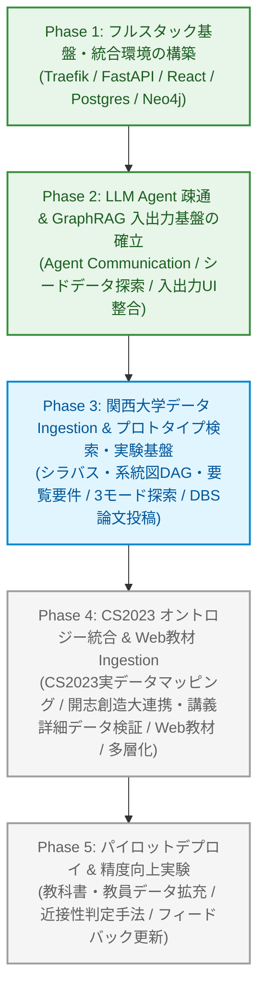

# 研究・開発ロードマップ (Course Navigator Roadmap)

本書は、「Course Navigator」プロジェクトの研究・開発フェーズ、実験計画、および将来の機能拡張ロードマップを定義するドキュメントです。

---

## 1. プロジェクト理念と運用情報

### 定例ミーティング

- **開催日時**: 毎週水曜日 20:00〜21:00（最大23:00まで延長可）
- **タイムゾーン**: Asia/Tokyo
- **ビデオ通話リンク**: [Google Meet](https://meet.google.com/zca-atth-zoh)

### 非営利プロジェクト方針

本プロジェクトは **非営利の学術研究目的** で実施されます。

- API 利用料金等の運用コストと相殺できるような持続可能な運用枠組みを目指します。
- 万が一、プロジェクト活動を通じて利潤が発生した場合は、関与したメンバーの所属大学（卒業済みの場合は出身大学）に研究振興費として均等に寄付します。大学在籍経験がないメンバーがいる場合は一般社団法人情報処理学会へ寄付します。

---

## 2. フェーズ別全体像 (Overview)

---

## 3. 各フェーズの詳細と実験項目

### Phase 1: フルスタック基盤・統合環境の構築 【完了】

- **目的**: Docker Compose と Traefik を用いて、Web（Backend/Frontend）および複合DB（PostgreSQL, Neo4j）の開発環境を整備し、全コンテナ間の双方向疎通を確立する。
- **実施内容**:
  - [x] Traefik v3.6 リバースプロキシによるドメイン・パスルーティングの確立 (`/`, `/api`, `/browser`)
  - [x] FastAPI (Python 3.14 / uv) と React 19 (Vite + TypeScript) のコンテナ構築
  - [x] PostgreSQL (asyncpg 接続プール) と Neo4j (APOC プラグイン導入・Bolt 接続) の初期化基盤実装
  - [x] Backend ⇄ PostgreSQL / Neo4j へのテストクエリ疎通完了

---

### Phase 2: LLM Agent 疎通 & GraphRAG 入出力基盤の確立 【完了 / Phase 3へ統合】

- **目的**: ユーザー側のデータ **Input（履修希望・条件・自然言語での対話）** と **Output（履修プラン提案・グラフ探索結果・UI表示）** のインターフェース整合性を最優先で確立する。シードデータやダミーデータを活用し、Agent と GraphRAG のエンドツーエンドのパイプラインを先行して成立させる。
- **実施内容・実験項目**:
  - [x] **実験 2-1: Agent 疎通とワークフロー構築（ADK / FastAPI 連携）**
    - LLM API と Backend を連携させ、ユーザーの入力に応じたプロンプト管理およびエージェントの思考・ツール呼び出しワークフローを構築。
  - [x] **実験 2-2: Neo4j MCP / Cypher 生成ツールの検証**
    - LLM が自然言語の履修相談から適切な Cypher クエリを発行し、Neo4j から前提条件ツリーや関連講義を取得できるかを検証。
  - [x] **実験 2-3: 静的エージェント (static_agent) による入出力 UI 疎通テスト**
    - 20件程度のシードデータ（講義情報・履修系統図）をもとに、Frontend の対話 UI と Backend Agent 間でデータ Input/Output が正確に送受信・可視化されるかを確認。
  - [x] **実験 2-4: カリキュラム制約統合推論 (Constraint Integration)**
    - 大学の履修上限単位数や時間割重複を考慮し、エージェントが制約を遵守した提案を出力できるか検証（Phase 3.5 の要覧要件モデルへ統合完了）。
  - [x] **実験 2-5: Vector vs Graph 検索性能・制約充足比較検証（予備実験）**
    - シード20科目・Golden 14問を対象に、Pure Vector / Pure Graph / Hybrid の予備比較実験を実施（[実験記録](experiments/2026-10-13_seed-retrieval-eval.md) 参照）。この知見を実データ規模（関西大学1,029科目）の探索比較（Phase 3.7 / 実験 3-5）へ昇華。

---

### Phase 3: 関西大学データ Ingestion & プロトタイプ検索・実験基盤 【進行中】

_（方針改訂: 2026-10-29 / [ADR-0015](adr/0015-pivot-from-komazawa-to-kansai-ingestion.md)）_

> [!NOTE]
> **長崎大学・駒澤大学から関西大学へのピボット経緯**
> 1. **長崎大学からのピボット ([ADR-0011](adr/0011-pivot-from-nagasaki-to-komazawa-ingestion.md))**: 一般公開シラバスが教養科目のみで専門科目が学外非公開だったため、身近な駒澤大学へピボット。
> 2. **駒澤大学から関西大学へのピボット ([ADR-0015](adr/0015-pivot-from-komazawa-to-kansai-ingestion.md))**: 駒澤大学の公式Webサーバー停止に伴い、シラバスインデックス等の外部取得が停止したため凍結保持。代替として、認証不要の静的HTMLシラバスおよび履修系統図ベクターPDFが取得可能で、研究チームに関西大学の所属学生が在籍する **関西大学（環境都市工学部等）へのピボット** を実施しました。

- **目的と基本方針**:
  - 外部オントロジー（CS2023）への急行を避け、**学内公式データ（シラバス・系統図・要覧）の徹底的な構造化と高信頼な履修検索基盤の確立** にフォーカスする（[長期Ingestion実装計画書](long_term_ingestion_plan.md) 参照）。
  - 意味的適合性とカリキュラム順序制約のトレードオフを解明する **直交探索アブレーション実験（Pure Vector vs Pure Graph vs Hybrid）** を実施し、その成果を査読付き研究会に論文投稿する。

#### サブフェーズ進捗
- [x] **Phase 3.0: 関西大学シラバス & 履修系統図 Ingestion 基盤**
  - 関西大学シラバス全1,029科目の静的HTMLパース（固有DOM ID 33項目を完全抽出）。
  - 環境都市工学部 履修系統図ベクターPDFからのグループDAG（有向グラフ）抽出。
  - PostgreSQL（courses）および Neo4j（Course, CurriculumGroup, リレーション）へのロードとクロスDB完全突合検証ツールの実装（[ADR-0016](adr/0016-neo4j-curriculum-dag-and-course-loader-architecture.md), [ADR-0017](adr/0017-postgres-schema-and-verification-tool-for-course-ingestion.md)）。
- [x] **Phase 3.5: 大学要覧・履修要件パイプライン**
  - 大学要覧PDF（`all_page.pdf`）の学部スプリット処理。
  - 科目区分（必修/選必/選）および卒業要件の決定論的パースと DB（PostgreSQL & Neo4j）格納・整合性検証。
- [x] **Phase 3.6: シラバス Embedding 生成 & マルチベクトル基盤**
  - シラバス統合テキストから Embedding（Gemini 768次元 / text-embedding-3-small 1536次元）を生成・キャッシュ。
  - Neo4j Vector Index（`course_embedding_index`）の構築。
  - NumPy による高速コサイン類似度マトリクス計算と、セマンティック類似度エッジ（`[:SIMILAR_TO]`）の永続化。
  - _（※本番アプリでは Neo4j Vector Index を採用し、pgvector による Pure Vector 探索は比較実験専用ブランチに分離）_
- [x] **Phase 3.7: 3モード探索エンジン & 評価ハーネス基盤（実装完了・評価実施中）**
  - Neo4j Cypher による 3つの探索モード（Pure Graph / Similarity Vector / Proposed Hybrid）のバックエンド実装。
  - LLM Agent 用 Cypher 探索ツール群（`agent/cypher_tools.py`）の実装。
  - フロントエンド検証 UI（`/test4-1` CypherSearchTest）および Navi 統合 API の実装。
- [ ] **Phase 3.8: 全学（13学部）への水平展開 【将来計画】**
  - 他学部の履修系統図・要覧パーサー展開、副専攻・学部横断カリキュラムグラフの構築。

#### 主なタスク・実験項目
- [x] **実験 3-1: 関西大学 シラバス & カリキュラムの Ingestion**
  - シラバス・履修系統図の収集・抽出・投入完了。
- [x] **実験 3-2: 実データに基づく GraphRAG 検索・推論の結合**
  - 1,029科目の実データに対する Neo4j Cypher 探索と Agent ツールの連携完了。
- [ ] **タスク 3-3: Frontend の拡張とユーザー向け微調整**
  - 学生が実際に利用できるよう、チャット UI の洗練、前提科目ツリー表示補助、Navi画面の最適化を実施。
- [ ] **実験 3-4: 学生インタビュー実験（定性評価）**
  - 関西大学の所属学生を対象にプロトタイプを試用してもらい、「履修判断の納得感や探索摩擦がどう変化したか」をインタビューにより定性検証。
- [ ] **実験 3-5: データベースによる直交探索比較実験（Pure Vector vs Pure Graph vs Hybrid）**
  - 情報モダリティの観点で直交する 3方式（① PostgreSQL/pgvector による意味検索、② Neo4j によるトポロジー走査、③ Neo4j 内蔵 Vector+Cypher による提案ハイブリッド手法）を実装・比較。
  - 意味的適合度（Precision@10）、前提順序充足度（Path Coverage [%]）、および応答性能（P95 Latency [ms]）をベンチマーク測定し、意味適合性とカリキュラム順序制約の相補的トレードオフを定量的に実証。
- [ ] **（先行準備・並行検討）タスク 3-6: 開志創造大学との共同研究テーマ設計およびデータアクセス準備（交渉中）**
  - Phase 4 に向け、教育系教員との意見交換や、授業スライド・字幕データの提供に向けたデータアクセス・倫理的配慮の体制構築を並行して推進。

#### Phase 3 完了マイルストーン
- **学会論文投稿: 冬のDBS/IFAT/DE合同研究会2026**
  - **対象会議**: 情報処理学会 第184回 DBS / 第165回 IFAT / 電子情報通信学会 DE 合同研究会（2026年12月18日〜19日、金沢＋オンライン）
  - **投稿締切**: **2026年11月13日（金）原稿締切**
  - **内容**: 学内データ構造化基盤および実験 3-5 の比較検証結果を取りまとめた研究論文を投稿（※発表と投稿のタイムラグを考慮し、論文投稿をもって Phase 3 の達成マイルストーンとする）。

---

### Phase 4: CS2023 基準オントロジー統合 & Web教材 Ingestion 【未着手 / 次期フェーズ】

- **目的**: 学内データの徹底活用（Phase 3）の完了後、本来の目標である **国際標準 ACM/IEEE CS2023 オントロジー** を Neo4j に投入。大学の科目をオントロジーへ自動マッピングし、さらに学内でカバーできない領域を補完する学外 Web 公開教材（OCW / MOOCs 等）を取り込んで多層ナレッジグラフを完成させる。また、オンライン講義資産が豊富な **開志創造大学との共同研究連携（交渉中）** を通じて、シラバスのテキスト情報のみに依存しないマルチモーダルな講義詳細データ（字幕・スライド等）を活用したオントロジーマッチング高度化と実運用フィードバックの獲得を検証する。
- **開志創造大学との連携背景（交渉中）**:
  - **連携形態**: 開志創造大学側から「Course Navigatorを利用する研究テーマ」として参加する形をとり、双方にとって活動しやすい適度な自律性を担保した共同研究体制の構築を協議中。
  - **オンライン授業データの活用**: 開志創造大学の最大の強みである蓄積されたオンライン講義資産（字幕データ、講義スライド、教科書情報など）にアクセス可能な体制を教員主導で検討中。
  - **課題認識と仮説**: シラバスの記載（概要や到達目標）のみでは講義の実質的内容や解像度が不足し、CS2023 とのマッピング精度に限界が生じる可能性がある。字幕やスライド等の詳細データを活用することで、知識単位との適合判定が大幅に高度化できるかを検証する。
- **主なタスク・実験項目**:
  - **実験 4-1: CS2023 オントロジーのグラフモデリングと投入**
    - KA / KU / Topic / LO の階層ノードを Neo4j に投入。
  - **実験 4-2: LLM による学内科目 ↔ CS2023 オントロジーの自動推論マッピング**
    - 大学シラバスの内容から、LLM を用いて CS2023 のどの知識領域・トピックに対応するかを推論し、自動リンク (`[:MAPS_TO]`) を構築。
  - **実験 4-3: 外部公開 Web 教材の収集とオントロジーマッピング**
    - 大学公開講座 (OCW) や MOOCs を収集し、CS2023 のトピックに事前グラフ化して接続（大学内にない科目の補強）。
  - **実験 4-4: 開志創造大学との連携による詳細講義データ（字幕・スライド等）を活用したオントロジーマッチング高度化および実運用フィードバック実験（交渉中）**
    - **詳細講義データの活用・マッチング比較**: 開志創造大学のオンライン授業資産（講義字幕・スライド・教科書等）を取り込み、シラバス単体の場合と比べて CS2023 とのマッピング精度・解像度がどの程度向上するかを比較検証する。
    - **外部Web教材推薦との連動**: 詳細講義データの解析により学内カリキュラムで不足しているトピックを特定し、実験 4-3 で構築した外部Web教材（OCW/MOOCs等）を適切に補完推薦できるか実証する。
    - **実運用テストとフィードバック収集**: 開志創造大学の学生を対象にプロトタイプを実運用展開し、アクセスログ・対話ログの分析、およびアンケートやインタビューによる定性・定量フィードバックを収集して推薦の納得感や有用性を評価する。
    - **教員連携による教育的評価**: 開志創造大学の教育系教員等と連携し、教育的観点からカリキュラム整合性やシステムの実用性についての評価・知見を得る。
  - **タスク 4-5: プロダクト機能の本格拡充**
    - 時間割 Wishlist シミュレータ、アカウント・履修履歴管理、ナレッジマップ全体のインタラクティブ可視化。

---

### Phase 5: パイロットデプロイ & 検索生成の高度化・精度向上実験 【未着手】

- **目的**: 実際の大学環境へデプロイして学生・教員からフィードバックを収集し、検索・生成ロジックの精度向上を継続的に行う。
- **実験項目**:
  - **実験 5-1: シラバス教科書・レビュー情報のグラフ追加**
    - 教科書情報や書籍レビュー、推薦図書データをグラフに追加し、講義の実質的難易度や内容の解像度を高めた推薦精度の向上を検証。
  - **実験 5-2: 教員実績・研究分野情報の追加**
    - 担当教員の研究分野や過去の実績データをナレッジグラフに統合し、教員の専門性と講義の結びつきによるマッチング精度を検証。
  - **実験 5-3: グラフ近接性・マッピング判定手法の比較**
    - 科目間の関連度判定において、ベクトル類似度（Cosine）、トピック共起、およびグラフ構造距離（PageRank / 最短経路）の精度比較実験を実施（Phase 3.6/3.7 の知見をさらに発展）。
  - **実験 5-4: ユーザーフィードバックによる自動適応 (Active Learning)**
    - 履修相談結果に対するユーザーの満足度や選択結果をフィードバックとして蓄積し、推薦重みやプロンプトを自動更新する手法の実現可能性を検証。

---

## 4. 進捗・タスク管理方針

- **長期目標・実験計画**: 本ドキュメント (`docs/roadmap.md`) および [高度な学内データ活用および3つの探索実験基盤に向けた長期 Ingestion 実装計画書](long_term_ingestion_plan.md) で全体像を管理します。
- **アーキテクチャ設計・意思決定**: [アーキテクチャ設計書](architecture.md) および [ADR 一覧](adr/README.md)（ピボットやDB設計の経緯）に記録します。
- **実験計画・検証記録**: [実験計画と記録](experiments/README.md) で事前登録および実験結果を管理します。
- **日々のタスク・Issue**: GitHub Projects および GitHub Issues にブレークダウンし、コミットやプルリクエストと連動させて進捗を追跡します。
