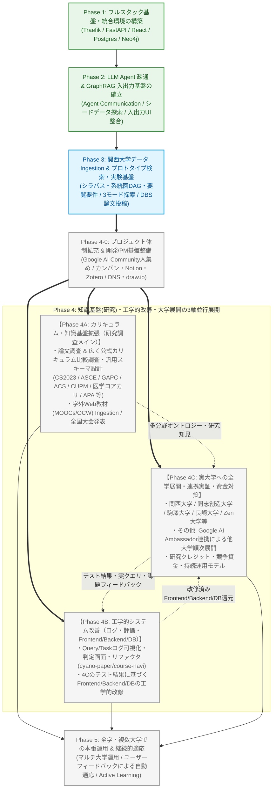

## 1. プロジェクト理念と運用情報

### 定例ミーティング

- **開催日時**: 毎週水曜日 20:00〜21:00（最大23:00まで延長可）
- **タイムゾーン**: Asia/Tokyo
- **ビデオ通話リンク**: [Google Meet](https://meet.google.com/zca-atth-zoh)

### 非営利プロジェクト方針

本プロジェクトは **非営利の学術研究目的** で実施されます。

- API 利用料金等の運用コストと相殺できるような持続可能な運用枠組みを目指します。
- 万が一、プロジェクト活動を通じて利潤が発生した場合は、関与したメンバーの所属大学（卒業済みの場合は出身大学）に研究振興費として均等に寄付します。大学在籍経験がないメンバーがいる場合は一般社団法人情報処理学会へ寄付します。

---

## 2. フェーズ別全体像 (Overview)

