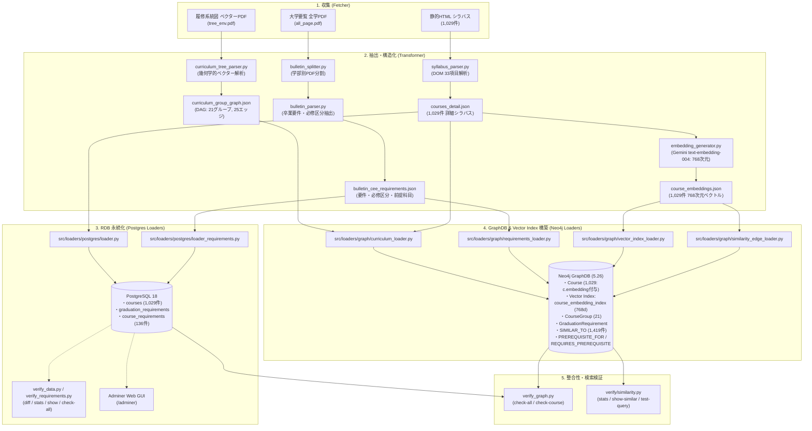

# Ingestion (データパイプライン & GraphRAG 構築バッチ)

本ディレクトリは、大学シラバス、カリキュラム系統図、および外部学習資源を収集・抽出し、**PostgreSQL (RDB)** および **Neo4j (GraphDB)** へ投入・グラフ構造化するための独立したデータパイプライン（バッチ処理基盤）です。

---

## 1. 概要と位置づけ

### 1.1 アーキテクチャ上の責務 (ADR-0008)

常時稼働する Web API (`backend/`) とはライフサイクルおよびコンテナランタイム要件を完全に分離し、ルート直下の独立サービスとして配置されています。

- **Web API (`backend/`)**: Alpine Linux ベース。軽量・高速な同期 API サーバー（FastAPI + Agent）。
- **Ingestion (`ingestion/`)**: Debian ベース。PDF 解析、スクレイピング、テキスト抽出、および Neo4j / PostgreSQL への一括バッチ投入を担うデータ基盤。

### 1.2 Phase 3 における注力方針: 関西大学 Ingestion へのピボット (ADR-0014)

> [!WARNING]
> **方針変更 (2026-10-29 / ADR-0014): 駒澤大学 Web 停止に伴う一時停止と関西大学へのピボット**
> 駒澤大学の公式 Web 停止に伴い、全学シラバスインデックスおよび履修系統図の外部取得が停止したため、駒澤大学向けの Ingestion は一時停止（凍結保持）としました。
> 代替として、認証不要の公開静的リソース（詳細シラバス HTML および環境都市工学部の履修系統図ベクター PDF）が利用可能であり、研究チーム内に所属学生が在籍する **関西大学** を対象とした Ingestion パイプラインを構築・実証しています（詳細は [ADR-0014](../docs/adr/0014-pivot-from-komazawa-to-kansai-ingestion.md) を参照）。

- **目的**: 最速で実データに基づくエンドツーエンドのプロトタイプ検索アプリを成立させ、学生による実証インタビュー実験を行うこと。
- **対象データ**:
  - 関西大学 開講科目の詳細シラバス（静的 HTML、全1,029科目）
  - 関西大学 環境都市工学部等の履修系統図（ベクター PDF、`tree_env.pdf`）
- **設計上の配慮**: Phase 3 の段階では CS2023 オントロジーへのマッピングは行わず、実シラバスと学内カリキュラム構造（DAG）のグラフ化に集中します（CS2023 / Web教材マッピングは Phase 4 にて実施）。

---

## 2. ディレクトリ構成

```text
ingestion/
├── README.md               # 本ドキュメント
├── Dockerfile              # Python (Debian Slim) ベースのバッチコンテナ定義
├── pyproject.toml          # uv パッケージ管理設定 (pypdf, pdfplumber, psycopg, neo4j 等)
├── uv.lock                 # 依存関係ロックファイル
├── data/                   # 収集元データおよび中間成果物
│   ├── raw/                # 取得した生 PDF / HTML シラバス
│   │   └── university/
│   │       ├── kansai/     # 関西大学の生データ（シラバスHTML, 履修系統図PDF）
│   │       ├── komazawa/   # 駒澤大学の生データ（凍結保持）
│   │       └── nagasaki/   # 長崎大学の生データ（凍結保持）
│   └── parsed/             # 構造化抽出済み JSON / Markdown データ
│       └── university/
│           ├── kansai/     # 関西大学の抽出済みデータ (courses_detail.json, curriculum_group_graph.json 等)
│           └── komazawa/   # 駒澤大学の抽出済みデータ (courses_summary.json)
└── src/
    ├── fetchers/           # 【Extract】シラバス等の生データ収集 (Fetcher)
    │   ├── kansai/         # 関西大学用フェッチャー (HTML, PDF)
    │   ├── komazawa/       # 駒澤大学用フェッチャー (凍結保持)
    │   └── nagasaki/       # 長崎大学用フェッチャー (凍結保持)
    ├── transformers/       # 【Transform】HTML / PDF 解析・構造化 (Transformer)
    │   ├── kansai/         # 関西大学用パーサー
    │   │   ├── schema.py   # シラバス詳細データ Pydantic スキーマ
    │   │   ├── syllabus_parser.py # 静的 HTML シラバスパーサー (全33 DOM ID 抽出)
    │   │   ├── tree_schema.py # 履修系統図グループ DAG スキーマ
    │   │   ├── curriculum_tree_parser.py # 系統図 PDF ベクター解析・DAG 抽出パーサー
    │   │   ├── bulletin_schema.py # 大学要覧・履修要件 Pydantic スキーマ
    │   │   ├── bulletin_splitter.py # 要覧 PDF 学部別スプリッター
    │   │   ├── bulletin_parser.py # 大学要覧 PDF からの卒業要件・必修区分抽出パーサー
    │   │   └── embedding_generator.py # シラバス Embedding 生成モジュール (Phase 3.6A)
    │   ├── komazawa/       # 駒澤大学用パーサー群 (凍結保持)
    │   └── nagasaki/       # 長崎大学用パーサー (凍結保持)
    └── loaders/            # 【Load】データベース一括投入 (Loader)
        ├── postgres/       # PostgreSQL 用ローダー・検証基盤 (ADR-0015)
        │   ├── db.py       # DB 接続マネージャー (psycopg v3)
        │   ├── schema.py   # courses テーブル DDL 定義
        │   ├── loader.py   # コース一括 Upsert & トランザクションローダー
        │   ├── verify_data.py # データ検証・完全突合 CLI ツール
        │   ├── schema_requirements.py # 卒業要件・必修区分テーブル DDL
        │   ├── loader_requirements.py # 要件データ一括 Upsert ローダー
        │   └── verify_requirements.py # 要件データ検証 CLI ツール
        └── graph/          # Neo4j 投入ロジック（UNWIND バッチ・Cypher制約）(ADR-0016)
            ├── schema.py   # ノード・リレーション定義・Cypher クエリ
            ├── curriculum_loader.py # 関西大学 カリキュラムDAG & コース一括ローダー
            ├── requirements_loader.py # 卒業要件オントロジー & 前提科目エッジローダー
            ├── vector_index_loader.py # Neo4j Embedding 格納 & Vector Index 作成 (Phase 3.6A)
            ├── similarity_edge_loader.py # コサイン類似度マトリクス計算 & [:SIMILAR_TO] ローダー (Phase 3.6A)
            ├── verify/     # Neo4j 検証ツール群 (CLI)
            │   └── similarity.py # Embedding・Vector Index・類似エッジ検証 CLI
            ├── verify_graph.py # Neo4j & PostgreSQL クロスDB整合性検証 CLI
            └── loader.py   # 駒澤大学用レガシーローダー (凍結保持)
```

---

## 3. 実装状況サマリー (Status & Progress)

### 3.1 実装完了項目 (Completed)

* **[Extract] シラバスHTML・履修系統図PDFの一括収集 (Fetcher)**:
  * [`src/fetchers/kansai/fetch_syllabus.py`](src/fetchers/kansai/fetch_syllabus.py)
  * 関西大学シラバス検索システムから全1,029科目のカタログおよび詳細HTMLを安定取得。
  * 環境都市工学部の履修系統図ベクターPDF（`tree_env.pdf`）の収集。
* **[Transform] シラバス詳細解析・クレンジング (Syllabus Parser)**:
  * [`src/transformers/kansai/syllabus_parser.py`](src/transformers/kansai/syllabus_parser.py), [`src/transformers/kansai/schema.py`](src/transformers/kansai/schema.py)
  * 静的 HTML に割り当てられた 33 個の固有 DOM ID（科目名、単位、配当年次、講義概要、15週講義計画、成績評価基準、教科書情報等）を完全パース。
  * 全 1,029 件の構造化（エラー0件）、`courses_detail.json` および `courses_lookup.json` を出力。
* **[Transform] 履修系統図ベクターPDF解析 & DAG 抽出 (Curriculum Tree Parser)**:
  * [`src/transformers/kansai/curriculum_tree_parser.py`](src/transformers/kansai/curriculum_tree_parser.py), [`src/transformers/kansai/tree_schema.py`](src/transformers/kansai/tree_schema.py)
  * `tree_env.pdf`（Page 6: エネルギー環境・化学工学科）の直線・矢印ベクターパスおよび科目テキストの幾何学的バウンディングボックス解析。
  * 科目グループ枠（21件）、所属科目（70件）、グループ間有向前提エッジ（25本）の DAG（`curriculum_group_graph.json`）を抽出完了。
* **[Load] PostgreSQL コースデータ永続化 (Postgres Loader / ADR-0015)**:
  * [`src/loaders/postgres/loader.py`](src/loaders/postgres/loader.py), [`src/loaders/postgres/schema.py`](src/loaders/postgres/schema.py)
  * `courses` テーブル（ハイブリッド設計: スカラー列 + `TEXT[]` + `JSONB`）への一括 Upsert（500件バッチ、単一トランザクション保証）。
  * 全 1,029 科目の投入完了と自動 `diff` 検証による差分ゼロ確認。
* **[Verify] PostgreSQL データ検証・完全突合 CLI (Postgres Verifier / ADR-0015)**:
  * [`src/loaders/postgres/verify_data.py`](src/loaders/postgres/verify_data.py)
  * テーブル総件数・カラム充足率（`stats`）、特定科目整形プレビュー（`show`）、元 JSON との総当たり完全突合（`diff`）、任意 SQL 実行（`query`）を完備。
* **[Load] Neo4j カリキュラムDAG & コース一括投入 (Graph Loader / ADR-0016)**:
  * [`src/loaders/graph/curriculum_loader.py`](src/loaders/graph/curriculum_loader.py), [`src/loaders/graph/schema.py`](src/loaders/graph/schema.py)
  * 推測的技術（APOC/GDS）を排し、純粋な Cypher `UNWIND $batch` によりコースノードおよび DAG を一括投入（7.98秒）。
  * ノード: `Course` (1,029件), `CourseGroup` (21件), `DiplomaPolicy` (4件), `Professor`, `Department`, `Faculty`
  * エッジ: `[:PREREQUISITE_FOR]` (25件), `[:BELONGS_TO_GROUP]`, `[:CONTRIBUTES_TO]`, `[:TAUGHT_BY]`, `[:BELONGS_TO]`, `[:OFFERED_BY]`
* **[Verify] Neo4j & PostgreSQL クロスDB整合性検証 CLI (ADR-0016)**:
  * [`src/loaders/graph/verify_graph.py`](src/loaders/graph/verify_graph.py)
  * `syllabus_id` を主キーとして Neo4j と PostgreSQL の全件クロス突合を行い、100% 破綻なく結合できることを自動検証（`check-all`, `check-course`, `check-groups`）。
* **[Transform] 大学要覧 PDF からの卒業要件・必修区分抽出 (Bulletin Parser / Phase 3.5)**:
  * [`src/transformers/kansai/bulletin_splitter.py`](src/transformers/kansai/bulletin_splitter.py), [`src/transformers/kansai/bulletin_parser.py`](src/transformers/kansai/bulletin_parser.py), [`src/transformers/kansai/bulletin_schema.py`](src/transformers/kansai/bulletin_schema.py)
  * 関西大学の全学大学要覧 PDF（`all_page.pdf`）から環境都市工学部部分を高速スプリット（`bulletin_env_urban_eng.pdf`）。
  * 学部・学科別の卒業要件（総単位数128、必修53、選択必修30）および科目一覧表から必修/選択必修/選択の区分（77科目）を抽出。シラバスとの表記揺れ（ローマ数字・全角半角・サブタイトル）を正規化し、開講科目に対して 100% 決定論的マッチングを実現（`bulletin_cee_requirements.json` 出力）。
* **[Load] PostgreSQL 卒業要件・履修区分データ永続化 (Postgres Requirements Loader / Phase 3.5)**:
  * [`src/loaders/postgres/loader_requirements.py`](src/loaders/postgres/loader_requirements.py), [`src/loaders/postgres/schema_requirements.py`](src/loaders/postgres/schema_requirements.py)
  * `graduation_requirements`（学科卒業要件サマリー）および `course_requirements`（科目×学科ごとの必修区分・配当年次・シラバスID照合テーブル）を作成・一括 Upsert。
  * シラバスIDが存在する開講科目の 100% 外部キー突合整合性を担保（136件登録）。
* **[Verify] PostgreSQL 要件データ検証 CLI (Postgres Requirements Verifier / Phase 3.5)**:
  * [`src/loaders/postgres/verify_requirements.py`](src/loaders/postgres/verify_requirements.py)
  * 外部キー整合性・単位充足率を検証する `check-all`、統計サマリー `stats`、科目ごとの要件照会 `show <syllabus_id>` を提供。
* **[Load] Neo4j 卒業要件オントロジー & 前提科目エッジ構築 (Neo4j Requirements Loader / Phase 3.5)**:
  * [`src/loaders/graph/requirements_loader.py`](src/loaders/graph/requirements_loader.py)
  * ノード: `GraduationRequirement`（学科卒業要件）, `RequirementCategory`（必修/選択必修/選択カテゴリ）
  * エッジ: `[:HAS_CATEGORY]`, `[:CLASSIFIED_AS]`（Course とカテゴリの接続、136件）, `[:REQUIRES_PREREQUISITE]`（要覧公式規程に基づく特別研究着手要件前提エッジ: 特別研究Ⅱ → 特別研究Ⅰ、化学工学実験・有機化学実験など）
* **[Transform] シラバス Embedding 生成 & キャッシュ管理 (Embedding Generator / Phase 3.6A)**:
  * [`src/transformers/kansai/embedding_generator.py`](src/transformers/kansai/embedding_generator.py)
  * シラバスの科目名、副題、講義概要、到達目標、15週講義計画を統合した構造化テキストを構築。
  * Google Gemini（`text-embedding-004` / 768次元）および決定論的モックフォールバック（SHA-256ベース）により全1,029科目の正規化埋め込みベクトルを生成・キャッシュ（`course_embeddings.json`）。
* **[Load] Neo4j Vector Index 構築 & Embedding 格納 (Vector Index Loader / Phase 3.6A)**:
  * [`src/loaders/graph/vector_index_loader.py`](src/loaders/graph/vector_index_loader.py)
  * 全1,029件の `(:Course)` ノードに `c.embedding`（768次元 float リスト）をバッチ付与。
  * Neo4j 5.x ネイティブ Vector Index `course_embedding_index`（コサイン距離、768次元）を作成・ONLINE 化完了。
  * Cypher 動的ベクトル検索 `CALL db.index.vector.queryNodes` の通電を確認。
* **[Load] コサイン類似度マトリクス計算 & セマンティック類似度エッジ投入 (Similarity Edge Loader / Phase 3.6A)**:
  * [`src/loaders/graph/similarity_edge_loader.py`](src/loaders/graph/similarity_edge_loader.py)
  * NumPy を用いた $1,029 \times 1,029$ コサイン類似度マトリクスの高速計算（約0.03秒）。
  * 自己ループ除外、スコア閾値（$\ge 0.70$）、Top-K（最大5件）フィルタにより、1,419 件の `(:Course)-[:SIMILAR_TO {score, model}]->(:Course)` エッジを一括バッチロード。
* **[Verify] Neo4j Embedding & 類似度エッジ検証 CLI (Similarity Verifier / Phase 3.6A)**:
  * [`src/loaders/graph/verify/similarity.py`](src/loaders/graph/verify/similarity.py)
  * ソースコードとテストコードを分離し、検証専用 CLI として配置。
  * `stats`（Embedding 充足率 100%、エッジ件数 1,419本、Index 稼働状況）、`show-similar <syllabus_id>`（類似科目照会）、`test-query <query_text>`（動的ベクトル探索テスト）を提供。
* **[Management] PostgreSQL Web 管理画面 (Adminer)**:
  * ブラウザから `courses` テーブルの全項目・JSONB を閲覧・検索可能な Adminer を Docker Compose / Traefik 配下に整備（`http://course-navigator.localhost/adminer`）。
* **[Archive] 駒澤大学・長崎大学パイプライン（凍結保持）**:
  * 駒澤大学向けシラバス（6,803件）のベースグラフ構築コード等を将来の再開に備えて維持。

### 3.2 今後の課題・拡張 (Pending / To-Do)

* **3つの探索モード評価ハーネスの構築 (Phase 3.7)**:
  * 論文精査LLMの仕様に基づくゴールデン質問セットによる探索ベンチマーク測定（適合度・前提制約充足率・レイテンシ）。
* **実験用ブランチでの pgvector 比較実験**:
  * メインブランチでは採用しない PostgreSQL (pgvector) による Pure Vector 方式を別ブランチにて構築・比較検証。
* **履修系統図の他学部・他学科への適用拡大**:
  * 現在検証済みのエネルギー環境・化学工学科（Page 6）に加え、環境都市工学部の他学科（都市システム工学科、建築学科等）および他学部のベクター PDF 解析の展開。
* **CS2023 オントロジー統合 (Phase 4)**:
  * ACM/IEEE CS2023 基準オントロジーノード群の投入と、学内科目との自動推論マッピング (`[:MAPS_TO]`)。

---

## 4. データ処理フロー (Kansai Univ.)



---

## 5. 実行手順（開発環境）

C 拡張ライブラリ（`psycopg` 等）や PDF 解析ツールの環境差異を防ぐため、**Docker コンテナ内での実行を標準**としています。

### 5.1 前提条件: 共有ネットワークと DB の起動

```bash
# 共有ネットワークの作成（初回のみ）
docker network create gateway

# PostgreSQL / Neo4j / Adminer の起動
docker compose -f db/compose.yaml up -d
```

### 5.2 ステップ別実行手順（関西大学パイプライン）

リポジトリルート直下から Docker Compose（`tools` プロファイル）経由で実行します。

```bash
# 1. コンテナイメージのビルド（初回および pyproject.toml / Dockerfile 更新時）
docker compose --profile tools build ingestion

# 2. シラバス等の公式データ取得 (Fetcher)
docker compose --profile tools run --rm ingestion uv run python -m src.fetchers.kansai.fetch_syllabus

# 3. シラバス詳細解析・構造化 (Syllabus Parser)
docker compose --profile tools run --rm ingestion uv run python -m src.transformers.kansai.syllabus_parser

# 4. 履修系統図ベクターPDFからのグループDAG抽出 (Curriculum Tree Parser)
docker compose --profile tools run --rm ingestion uv run python -m src.transformers.kansai.curriculum_tree_parser --page 6

# 5. PostgreSQL へのコースデータ一括投入 (Postgres Loader)
docker compose --profile tools run --rm ingestion uv run python -m src.loaders.postgres.loader

# 6. PostgreSQL 格納データの完全突合検証 (Postgres Verifier)
docker compose --profile tools run --rm ingestion uv run python -m src.loaders.postgres.verify_data diff

# 7. Neo4j へのカリキュラムDAG & コース一括投入 (Graph Loader)
docker compose --profile tools run --rm ingestion uv run python -m src.loaders.graph.curriculum_loader

# 8. Neo4j & PostgreSQL クロスDB整合性検証 (Cross-DB Verifier)
docker compose --profile tools run --rm ingestion uv run python -m src.loaders.graph.verify_graph check-all

# --- Phase 3.5: 大学要覧・履修要件・卒業要件パイプライン ---

# 9. 大学要覧PDFの学部別スプリット（全学PDF -> 環境都市工学部PDF）
docker compose --profile tools run --rm ingestion uv run python -m src.transformers.kansai.bulletin_splitter

# 10. 大学要覧からの卒業要件・必修区分抽出
docker compose --profile tools run --rm ingestion uv run python -m src.transformers.kansai.bulletin_parser

# 11. PostgreSQL への要件データ一括投入 (Requirements Postgres Loader)
docker compose --profile tools run --rm ingestion uv run python -m src.loaders.postgres.loader_requirements

# 12. PostgreSQL 要件データの整合性検証 (Requirements Verifier)
docker compose --profile tools run --rm ingestion uv run python -m src.loaders.postgres.verify_requirements check-all
docker compose --profile tools run --rm ingestion uv run python -m src.loaders.postgres.verify_requirements stats

# 13. Neo4j への卒業要件オントロジー & 前提科目エッジ一括投入 (Requirements Neo4j Loader)
docker compose --profile tools run --rm ingestion uv run python -m src.loaders.graph.requirements_loader

# --- Phase 3.6A: Neo4j Embedding & セマンティック類似度エッジパイプライン ---

# 14. シラバス Embedding 生成（Gemini text-embedding-004 / 決定論的モック対応）
docker compose --profile tools run --rm ingestion uv run python -m src.transformers.kansai.embedding_generator

# 15. Neo4j Course ノードへの Embedding 投入 & Vector Index 作成
docker compose --profile tools run --rm ingestion uv run python -m src.loaders.graph.vector_index_loader

# 16. コサイン類似度マトリクス計算 & [:SIMILAR_TO] エッジ一括投入
docker compose --profile tools run --rm ingestion uv run python -m src.loaders.graph.similarity_edge_loader --threshold 0.70 --top-k 5

# 17. Neo4j Embedding・Vector Index・類似エッジ検証 CLI
docker compose --profile tools run --rm ingestion uv run python -m src.loaders.graph.verify.similarity stats
docker compose --profile tools run --rm ingestion uv run python -m src.loaders.graph.verify.similarity show-similar 011878
docker compose --profile tools run --rm ingestion uv run python -m src.loaders.graph.verify.similarity test-query "物理化学"
```

#### コンテナ内でインタラクティブに作業・デバッグする場合

```bash
# ingestion コンテナをバックグラウンド起動
docker compose --profile tools up -d ingestion

# コンテナ内シェルへ接続
docker compose exec ingestion bash

# （コンテナ内で実行）
uv run python -m src.loaders.graph.verify_graph check-all
```

---

## 5.3 各種ツール・機能の詳細リファレンス

### 5.3.1 PostgreSQL コースデータローダー (`loader.py`)

構造化シラバス JSON（`courses_detail.json`）を PostgreSQL の `courses` テーブルへ高速・安全・かつべき等（再実行可能）に一括投入（Upsert）する CLI スクリプトです。単一トランザクション保証（All-or-Nothing）で動作し、投入完了後に自動で元データ突合検証（`diff`）を実行して差分ゼロを判定します。

```bash
# 1. 安全確認（ドライラン: コミットせず全件ロールバック）
docker compose --profile tools run --rm ingestion uv run python -m src.loaders.postgres.loader --dry-run

# 2. 本番一括投入（デフォルト設定: 500件バッチ + 自動 diff 検証）
docker compose --profile tools run --rm ingestion uv run python -m src.loaders.postgres.loader

# 3. カスタムパスおよびバッチサイズを指定して投入
docker compose --profile tools run --rm ingestion uv run python -m src.loaders.postgres.loader --json data/parsed/university/kansai/2026/courses_detail.json --batch-size 1000

# 4. 高速実行（ロード後の自動突合検証をスキップ）
docker compose --profile tools run --rm ingestion uv run python -m src.loaders.postgres.loader --skip-verify
```

#### CLI 引数と実行オプション

| オプション | 型 / デフォルト値 | 説明 |
| :--- | :--- | :--- |
| `--json PATH` | `Path` / `data/parsed/university/kansai/2026/courses_detail.json` | 投入元となる構造化シラバス JSON のパス指定 |
| `--batch-size N` | `int` / `500` | 1回の `executemany` で一括送信するレコード件数 |
| `--dry-run` | フラグ (`action="store_true"`) | 実際にはコミットせず、データのバインド・投入シミュレーションのみを行いロールバックする安全確認フラグ |
| `--skip-verify` | フラグ (`action="store_true"`) | ロード完了後の自動 `diff` 検証ステップをスキップする高速化フラグ |

---

### 5.3.2 PostgreSQL データ検証・完全突合ツール (`verify_data.py`) (ADR-0015)

PostgreSQL 内の `courses` テーブルのデータ整合性をホスト・コンテナ側から1コマンドで検証・確認するための CLI ツールです。

```bash
# 1. テーブルおよびインデックスの初期化 (初回のみ)
docker compose --profile tools run --rm ingestion uv run python -m src.loaders.postgres.verify_data init-db

# 2. テーブル総件数・カラム別 NOT NULL 充足率・分布の確認
docker compose --profile tools run --rm ingestion uv run python -m src.loaders.postgres.verify_data stats

# 3. 特定科目の詳細表示 (時間割コード 64214 または シラバスID 162242)
docker compose --profile tools run --rm ingestion uv run python -m src.loaders.postgres.verify_data show 64214

# 4. 元データ JSON との完全自動突合 (差分ゼロ・完全一致の検証)
docker compose --profile tools run --rm ingestion uv run python -m src.loaders.postgres.verify_data diff --json data/parsed/university/kansai/2026/courses_detail.json

# 5. 任意の読み取り SQL の直接実行・表形式プレビュー
docker compose --profile tools run --rm ingestion uv run python -m src.loaders.postgres.verify_data query "SELECT subject_name, credits, semester, term_schedule FROM courses WHERE subject_name LIKE '%化学%' LIMIT 5;"
```

---

### 5.3.3 PostgreSQL Web 管理画面 (`Adminer`)

PostgreSQL の `courses` テーブルに格納された長文シラバス（`description`, `objectives`）や週別講義計画・成績評価基準などの JSONB カラム（`schedule_sessions`, `instructors` 等）を Web ブラウザ上で直感的に閲覧・検索・SQL 実行するための軽量 Web 管理 UI です。

FastAPI バックエンドを経由せず、`db/compose.yaml` 単体で独立起動します。独自のアカウント登録システムを持たないため、**メールアドレス登録等の初期サインアップは一切不要**です。外部へのポート直接公開は行わず、Traefik リバースプロキシ経由のサブパスでセキュアにアクセス可能です。

```bash
# DB レイヤー（PostgreSQL, Neo4j, Adminer）の起動
docker compose -f db/compose.yaml up -d
```

- **アクセス URL**: `http://course-navigator.localhost/adminer`
- **セキュリティ・アーキテクチャ**:
  - ホストポート直接公開なし（Traefik 経由のサブパス `/adminer` 運用）
  - 単一 PHP スクリプトによる相対パス動作のため、ルート `/api`（FastAPI）とのパス競合が構造上発生しません
  - PostgreSQL 側のスキーマ汚染（不要な管理テーブル作成）ゼロ
- **ログイン手順**:
  1. ブラウザで `http://course-navigator.localhost/adminer` を開く
  2. ログインフォームを入力（「サーバ」欄は環境変数により自動で `postgres` が補完されます）：
     - **システム**: `PostgreSQL`
     - **サーバ**: `postgres`
     - **ユーザ**: `admin`
     - **パスワード**: `${POSTGRES_PASSWORD}`（`.env` に設定された DB パスワード）
     - **データベース**: `coursenavigator`
  3. 「ログイン」をクリックすると、即座にテーブル一覧が表示されます。
  4. `courses` テーブルの「データ選択」をクリックすると、1,029 件の講義一覧、全文検索、ソート、JSONB プレビューが確認できます。

---

### 5.3.4 カリキュラム系統図 DAG トランスフォーマー (`curriculum_tree_parser.py`)

履修系統図ベクター PDF（`tree_env.pdf`）から、**科目グループ枠（クラスター）**、**グループ所属科目**、および**グループ間の有向前提エッジ（DAG）**を幾何学的に抽出するスクリプトです。各科目は PostgreSQL の `courses` マスターデータと照合され、`syllabus_id` および `course_code` が自動付与されます（色解析は行わず、DB マスターデータを利用）。

```bash
# 1. Page 6（エネルギー環境・化学工学科）の DAG 抽出と Mermaid / JSON 出力
docker compose --profile tools run --rm ingestion uv run python -m src.transformers.kansai.curriculum_tree_parser --page 6

# 2. カスタムパスおよび出力先を指定して実行
docker compose --profile tools run --rm ingestion uv run python -m src.transformers.kansai.curriculum_tree_parser --pdf data/raw/university/kansai/2026/curriculum/tree_env.pdf --output-json data/parsed/university/kansai/2026/curriculum_group_graph.json --output-md data/parsed/university/kansai/2026/curriculum_extracted.md
```

---

### 5.3.5 Neo4j カリキュラム系統図 & コースデータローダー (`curriculum_loader.py`) (ADR-0016)

抽出された履修系統図グループ DAG（`curriculum_group_graph.json`）および詳細シラバスコースデータ（`courses_detail.json`）を Neo4j へ一括投入（Merge）するローダーです。APOC や GDS、ベクトル埋め込み等の推測的技術は使用せず、純粋な Cypher `UNWIND $batch` パランティア型オントロジーにより投入します。

```bash
# 1. デフォルト一括投入（Course, CourseGroup, DiplomaPolicy を Merge）
docker compose --profile tools run --rm ingestion uv run python -m src.loaders.graph.curriculum_loader

# 2. 該当学科の既存データをクリアしてから新規再ロード
docker compose --profile tools run --rm ingestion uv run python -m src.loaders.graph.curriculum_loader --clear-first

# 3. カスタムパスおよびバッチサイズを指定して投入
docker compose --profile tools run --rm ingestion uv run python -m src.loaders.graph.curriculum_loader --tree data/parsed/university/kansai/2026/curriculum_group_graph.json --courses data/parsed/university/kansai/2026/courses_detail.json --batch-size 1000
```

#### Neo4j グラフモデル・オントロジー
- **ノード**:
  - `(:Course {syllabus_id, course_code, timetable_code, name, credits, semester, term_schedule, detail_url})`
  - `(:CourseGroup {group_id, label, academic_year, semester, faculty, department})`
  - `(:DiplomaPolicy {code, name, faculty, department})`
  - `(:Professor {name, code})`, `(:Department {code})`, `(:Faculty {name})`
- **リレーション**:
  - `(:CourseGroup)-[:PREREQUISITE_FOR {edge_type, is_major}]->(:CourseGroup)`
  - `(:CourseGroup)-[:CONTRIBUTES_TO {edge_type}]->(:DiplomaPolicy)`
  - `(:Course)-[:BELONGS_TO_GROUP]->(:CourseGroup)`
  - `(:Course)-[:TAUGHT_BY {is_primary}]->(:Professor)`
  - `(:Course)-[:BELONGS_TO]->(:Department)`
  - `(:Course)-[:OFFERED_BY]->(:Faculty)`

---

### 5.3.6 Neo4j & PostgreSQL クロスデータベース整合性検証 CLI (`verify_graph.py`) (ADR-0016)

Neo4j GraphDB と PostgreSQL RDB の両方に接続し、データ件数、DAG トポロジー、および主キー（`syllabus_id`）の完全一致・相互結合性を検証する CLI ツールです。

```bash
# 1. 全体整合性・ノード数・エッジ数・クロスDB 100% 紐付け検証
docker compose --profile tools run --rm ingestion uv run python -m src.loaders.graph.verify_graph check-all

# 2. 特定科目のクロスDB結合インスペクション (Graph コンテキスト + RDB 詳細シラバス)
docker compose --profile tools run --rm ingestion uv run python -m src.loaders.graph.verify_graph check-course 162242

# 3. カリキュラム CourseGroup の DAG 前提・後続関係一覧表示
docker compose --profile tools run --rm ingestion uv run python -m src.loaders.graph.verify_graph check-groups
```

---

### 5.3.7 大学要覧・履修要件ローダー & 検証 CLI (Phase 3.5)

大学要覧（`all_page.pdf`）から抽出した学科卒業要件、科目別必修区分、および公式規程に基づく特別研究着手要件前提エッジを PostgreSQL および Neo4j に投入・検証するツール群です。

#### PostgreSQL 要件ローダー & 検証 CLI (`loader_requirements.py`, `verify_requirements.py`)

```bash
# 1. PostgreSQL への要件データ一括 Upsert
docker compose --profile tools run --rm ingestion uv run python -m src.loaders.postgres.loader_requirements

# 2. ドライラン（DB にコミットせずロールバック）
docker compose --profile tools run --rm ingestion uv run python -m src.loaders.postgres.loader_requirements --dry-run

# 3. 外部キー整合性・単位数完全チェック
docker compose --profile tools run --rm ingestion uv run python -m src.loaders.postgres.verify_requirements check-all

# 4. 統計サマリー表示（登録科目数・必修区分内訳・単位数合計）
docker compose --profile tools run --rm ingestion uv run python -m src.loaders.postgres.verify_requirements stats

# 5. 特定科目の必修区分・配当年次の照会（シラバスID または 科目名）
docker compose --profile tools run --rm ingestion uv run python -m src.loaders.postgres.verify_requirements show 64224
docker compose --profile tools run --rm ingestion uv run python -m src.loaders.postgres.verify_requirements show "物理化学１"
```

#### Neo4j 卒業要件オントロジー & 前提科目エッジローダー (`requirements_loader.py`)

```bash
# 1. Neo4j への要件オントロジー & 前提科目エッジ投入
docker compose --profile tools run --rm ingestion uv run python -m src.loaders.graph.requirements_loader

# 2. 該当学科の要件ノード・エッジをクリアしてから新規再ロード
docker compose --profile tools run --rm ingestion uv run python -m src.loaders.graph.requirements_loader --clear-first
```

- **ノード**:
  - `(:GraduationRequirement {requirement_id, academic_year, faculty_code, faculty_name, department_code, department_name, total_credits, major_required_credits, major_elective_required_credits})`
  - `(:RequirementCategory {category_id, name, requirement_type, required_credits})`
- **リレーション**:
  - `(:GraduationRequirement)-[:HAS_CATEGORY]->(:RequirementCategory)`
  - `(:Course)-[:CLASSIFIED_AS {requirement_type, department_code}]->(:RequirementCategory)`
  - `(:Course)-[:REQUIRES_PREREQUISITE {reason, condition_type}]->(:Course)`
    - 例: `(:Course {name: '特別研究２'})-[:REQUIRES_PREREQUISITE]->(:Course {name: '特別研究１'})`

---

### 5.3.8 Neo4j Embedding 生成・Vector Index & 類似度エッジローダー (Phase 3.6A)

シラバス詳細データから Embedding を生成し、Neo4j 5.x 内蔵 Vector Index `course_embedding_index` の作成、および NumPy コサイン類似度計算による `[:SIMILAR_TO]` エッジのバッチ投入・検証を行うツール群です。

#### 1. シラバス Embedding 生成モジュール (`embedding_generator.py`)

```bash
# 1. デフォルト実行（Gemini text-embedding-004、未設定時は自動モックフォールバック）
docker compose --profile tools run --rm ingestion uv run python -m src.transformers.kansai.embedding_generator

# 2. 強制モック生成（テスト・CI用、決定論的SHA-256生成）
docker compose --profile tools run --rm ingestion uv run python -m src.transformers.kansai.embedding_generator --mock

# 3. キャッシュ無視・強制再計算
docker compose --profile tools run --rm ingestion uv run python -m src.transformers.kansai.embedding_generator --force
```

> [!TIP]
> **API による実行ができない場合の検証・診断 CLI (`services.embedding`)**
> Gemini API キーの設定不備や認証・権限エラー等により Embedding 生成が実行できない場合、公式 Google GenAI SDK による診断機能 `src.services.embedding` を実行して疎通状態やエラー原因を即座に特定できます。
>
> ```bash
> # 環境変数 GEMINI_API_KEY を用いて診断を実行
> docker compose --profile tools run --rm ingestion uv run python -m src.services.embedding
>
> # または検証したい API キーを直接引数に渡して実行
> docker compose --profile tools run --rm ingestion uv run python -m src.services.embedding --key "YOUR_API_KEY"
> ```
>
> **診断ツールがチェック・提示する内容**:
> - **キー形式検査**: 文字数、プレフィックス（`AIza` / `AQ.`）、不要なクォートや空白の混入有無
> - **疎通テスト**: Google 公式 SDK (`google-genai`) による Embedding 生成疎通（768次元ベクトルの検証）
> - **トラブルシューティング処方箋**: エラー内容に応じた具体的な対策（Google Cloud 上での「Generative Language API」の有効化、API キー制限の確認、AI Studio での再発行案内など）を自動提示

#### 2. Neo4j Course ノードへの Embedding 投入 & Vector Index 構築 (`vector_index_loader.py`)

```bash
# 1. Embedding を Course ノードへセットし、course_embedding_index を作成
docker compose --profile tools run --rm ingestion uv run python -m src.loaders.graph.vector_index_loader
```

- **Vector Index 定義**:
  - `course_embedding_index` FOR `(c:Course)` ON `(c.embedding)`
  - Options: `vector.dimensions: 768`, `vector.similarity_function: 'cosine'`

#### 3. コサイン類似度マトリクス計算 & `[:SIMILAR_TO]` エッジローダー (`similarity_edge_loader.py`)

```bash
# 1. 類似度スコア >= 0.70、各科目上位5件の類似エッジを投入
docker compose --profile tools run --rm ingestion uv run python -m src.loaders.graph.similarity_edge_loader --threshold 0.70 --top-k 5

# 2. 既存の [:SIMILAR_TO] エッジをクリアしてから新規投入
docker compose --profile tools run --rm ingestion uv run python -m src.loaders.graph.similarity_edge_loader --clear-first
```

- **エッジプロパティ**:
  - `(:Course)-[:SIMILAR_TO {score: float, model: str, updated_at: datetime}]->(:Course)`

#### 4. Neo4j Embedding・類似度エッジ検証 CLI (`verify/similarity.py`)

```bash
# 1. ノード充足率・Vector Index 稼働状況・エッジ件数・スコア統計
docker compose --profile tools run --rm ingestion uv run python -m src.loaders.graph.verify.similarity stats

# 2. 特定科目の接続先類似科目一覧（スコア降順）
docker compose --profile tools run --rm ingestion uv run python -m src.loaders.graph.verify.similarity show-similar 011878
docker compose --profile tools run --rm ingestion uv run python -m src.loaders.graph.verify.similarity show-similar 64224

# 3. 動的ベクトルクエリ（CALL db.index.vector.queryNodes）の実行テスト
docker compose --profile tools run --rm ingestion uv run python -m src.loaders.graph.verify.similarity test-query "物理化学と熱力学"
```

---

### 5.4 凍結保持コンポーネント（駒澤大学・長崎大学）の実行

過去に実装されたコンポーネントも、将来の再開や他大学対応のために維持されています。

```bash
# 駒澤大学（全科目静的インデックス取得）
docker compose --profile tools run --rm ingestion uv run python -m src.fetchers.komazawa.fetch_data

# 駒澤大学（全科目パーサー）
docker compose --profile tools run --rm ingestion uv run python -m src.transformers.komazawa.parser

# 駒澤大学（Neo4j ベースグラフローダー）
docker compose --profile tools run --rm ingestion uv run python -m src.loaders.graph.loader

# 長崎大学（シラバスフェッチャー）
docker compose --profile tools run --rm ingestion uv run python -m src.fetchers.nagasaki.fetch_data
```

---

## 6. ロードマップと今後の展開

- [x] **Phase 3（完了）**: 関西大学 詳細シラバス（1,029件）の収集・解析および PostgreSQL への永続化（ADR-0014, ADR-0015）
- [x] **Phase 3（完了）**: 履修系統図ベクター PDF からの科目グループ DAG 幾何抽出（ADR-0014）
- [x] **Phase 3（完了）**: Neo4j カリキュラムオントロジー（Course, CourseGroup, DiplomaPolicy, PREREQUISITE_FOR）の一括構築（ADR-0016）
- [x] **Phase 3（完了）**: Neo4j & PostgreSQL クロスDB整合性検証基盤および Adminer Web UI の導入（ADR-0015, ADR-0016）
- [ ] **Phase 3.5（進行中/検討中）**: 履修系統図の他学部・他学科への適用拡大（環境都市工学部の他学科など）
- [ ] **Phase 4（次期）**: ACM/IEEE CS2023 基準オントロジー投入パイプラインの実装
- [ ] **Phase 4（次期）**: LLM による学内科目 ↔ CS2023 オントロジーの自動推論マッピング (`[:MAPS_TO]`)
- [ ] **Phase 4（次期）**: Web 公開教材（OCW / MOOCs 等）の収集・グラフ化パイプラインの追加
